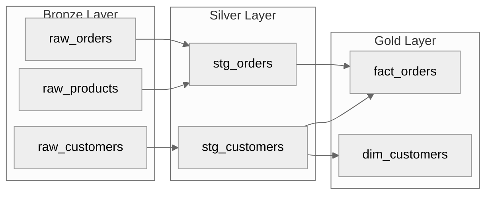
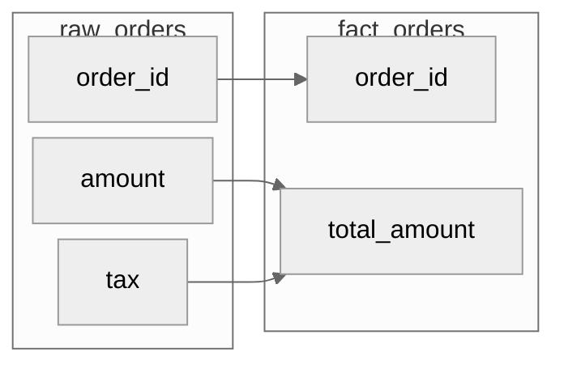

# Lineage

コードベースからデータリネージを抽出し、Mermaid 図として出力する。テーブルレベルおよびカラムレベルのリネージに対応する。

---

## 実行手順

### 1. リネージの抽出

```bash
/lineage path/to/pipelines/
/lineage path/to/models/ --level column
```

対象ファイルを解析し、以下の情報を抽出する:
- ソーステーブル（読み込み元）
- ターゲットテーブル（書き込み先）
- 変換ロジック（JOIN, 集計, フィルタ）
- カラムマッピング（入力カラム -> 出力カラム）

### 2. 対応ソース形式

| 形式 | 解析対象 |
|------|---------|
| PySpark | `spark.read`, `df.write`, `spark.sql()` |
| SQL | `SELECT ... FROM`, `INSERT INTO`, `CREATE TABLE AS` |
| dbt | `ref()`, `source()`, model 定義 |
| Airflow DAG | Task 依存関係 |

---

## 出力形式

### テーブルレベルリネージ



### カラムレベルリネージ



---

## Impact Analysis 支援

リネージ情報に基づいて、スキーマ変更の影響分析を支援する。

```bash
/lineage impact --table raw_orders --column amount
```

出力例:
```markdown
## Impact Analysis: raw_orders.amount

### 影響を受けるテーブル
| テーブル | カラム | 変換 | レイヤー |
|---------|--------|------|---------|
| stg_orders | amount | CAST(amount AS DECIMAL) | Silver |
| fact_orders | total_amount | amount + tax | Gold |
| kpi_daily_revenue | revenue | SUM(total_amount) | Gold |

### 影響を受けるパイプライン
| パイプライン | ステップ | 影響度 |
|-------------|---------|--------|
| daily_orders_etl | transform | High |
| kpi_aggregation | aggregate | Medium |

### 影響を受けるダッシュボード
| ダッシュボード | チャート | データソース |
|---------------|---------|-------------|
| Revenue Dashboard | Daily Revenue | kpi_daily_revenue |
```

---

## Mermaid 図の生成ルール

- 方向は `LR`（左から右）を使用する（レイヤー間の流れが直感的）
- サブグラフで Medallion レイヤーをグループ化する
- ノード数が多い場合は `rankSpacing: 20` で間隔を縮小する
- SVG に変換する場合は `npx mmdc -i lineage.mmd -o lineage.svg -t neutral -b transparent` を使用する

---

## 注意事項

- リネージの抽出はコードの静的解析に基づくため、動的SQL やランタイム生成のクエリは対象外
- 定期的にリネージ図を更新し、実態との乖離がないか確認する
- 複雑なリネージは階層を分けて複数の図に分割する
- リネージ図はドキュメントリポジトリで管理し、スキーマ変更時に `/migration-plan` と併用する
