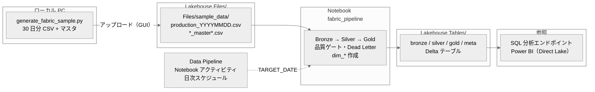

# Fabric デプロイガイド — 工場生産実績 ETL パイプライン

| 項目 | 値 |
|------|-----|
| 目的 | ローカルで検証済みのパイプラインを Microsoft Fabric 試用版に配置し、画面キャプチャ取得・ライブデモを行う |
| 対象者 | Fabric 試用版を新規に開始する担当者 |
| 所要時間 | 約 60〜90 分（Notebook のバックフィル実行 10〜20 分を含む。環境により変動） |
| 成果物 | Lakehouse 上の Bronze / Silver / Gold / meta テーブル、Power BI 用ディメンション、日次 Data Pipeline |
| 関連 | `notebook/fabric_pipeline.py`、`sample_data/`、`powerbi/semantic-model.md`、`design/security-entra-id.md` |

---

## 1. 全体像



<details>
<summary>Mermaid ソース</summary>



</details>

### 1.1 本ディレクトリの構成

| パス | 内容 |
|------|------|
| `notebook/fabric_pipeline.py` | Fabric Notebook 本体（`# %%` でセル区切り）。`05_implementation/src/` のロジックをミラーし、Gold は `03_schema/ddl/gold.sql` の列構成で出力する |
| `notebook/fabric_pipeline.ipynb` | 上記を `build_ipynb.py` で変換したもの。Fabric へのインポート用 |
| `notebook/build_ipynb.py` | `.py` → `.ipynb` 変換スクリプト（パラメーターセルに `parameters` タグを付与） |
| `sample_data/production_YYYYMMDD.csv` | 2026-10-01〜2026-10-30 の日次 MES CSV（30 ファイル、計 1,036 行） |
| `sample_data/line_master.csv` 他 | マスタ CSV 3 種（ライン・製品・設備） |
| `sample_data/generate_fabric_sample.py` | 上記サンプルの生成スクリプト（固定シードで再現可能） |
| `diagrams/fabric-deploy-flow.mmd` | 全体像の Mermaid ソース |

### 1.2 作成されるテーブル

Lakehouse のスキーマを有効にした場合の名前を示す。無効の場合はスキーマ接頭辞なしの名前（例: `daily_production_kpi`）になる。

| スキーマ | テーブル | 内容 | 書き込み方式（冪等性） |
|---------|---------|------|----------------------|
| `bronze` | `raw_production` | CSV の全列 STRING + メタデータ | `_ingested_date` パーティション上書き |
| `silver` | `production_facts` | 型変換・品質チェック・重複排除・計算列 | `production_date` パーティション上書き |
| `silver` | `equipment_master` | 設備マスタ（SCD Type 2） | 全量上書き（同日再実行は同結果） |
| `meta` | `dead_letter_production` | 品質ゲート不合格行 + `_rejection_reasons` | `_target_date` パーティション上書き |
| `meta` | `pipeline_run_log` | 日次実行結果（件数・エラー率・状態） | 追記（実行履歴） |
| `gold` | `daily_production_kpi` | 日次 × ライン KPI（`gold.sql` 準拠） | `production_date` パーティション上書き |
| `gold` | `equipment_health` | 日次 × 設備の健全性・7 日移動平均・アラート（`gold.sql` 準拠） | `production_date` パーティション上書き |
| `gold` | `dim_date` / `dim_line` / `dim_equipment` / `dim_product` / `dim_status` | Power BI 用ディメンション（`powerbi/semantic-model.md` 4 章と同じ列） | 全量上書き |

### 1.3 サンプルデータの特徴

| 特徴 | 内容 | ダッシュボードでの見え方 |
|------|------|------------------------|
| 規模 | 1 日 20〜40 行（日 × ライン × 製品 × シフト）。日曜は日勤のみ | 30 日分の日次トレンド |
| 劣化トレンド（温度） | `EQ-007`（LINE-004 射出成形機）の温度が徐々に上昇 | 2026-10-28〜30 に `temperature_alert` |
| 劣化トレンド（振動） | `EQ-003`（LINE-002 組立ロボット）の振動が徐々に増加 | 2026-10-28〜30 に `vibration_alert` |
| 品質トラブル | 2026-10-17 の LINE-003 で不良率が上昇（材料ロット不良を想定） | 不良率 5% 超のライン × 日が 2 件 |
| データ品質エラー | 10-08 / 10-15 / 10-22 / 10-27 に不正行を 1 行ずつ混入 | Dead Letter 4 行、当日の状態が `warning` |
| 再送重複 | 10-11 / 10-25 に MES 再送を模した重複を 1 行ずつ混入 | Silver で最新行のみ採用 |
| 工場 | LINE-001〜003 = `PLANT-A`、LINE-004〜005 = `PLANT-B` | 行レベルセキュリティ（RLS）のデモに使う |

サンプルを作り直す場合はローカルで次を実行する（同じシードなら同じ内容になる）。

```bash
cd demo/manufacturing-iot/08_fabric/sample_data
python generate_fabric_sample.py               # 2026-10-01 から 30 日分
python generate_fabric_sample.py --start 2026-11-01 --days 14   # 期間を変える場合
```

---

## 2. 手順一覧

「操作」列が **GUI** の手順は Fabric ポータル上での手作業である。メニュー名は UI の更新や表示言語で変わることがあるため、本書では代表的な表記を示す。見当たらない場合は同等の項目を探す。

| # | 手順 | 操作 | 所要時間 |
|---|------|------|---------|
| 0 | ローカル準備（ipynb 生成） | ローカル | 1 分 |
| 1 | Fabric 試用版の開始 | **GUI** | 5 分 |
| 2 | ワークスペースの作成 | **GUI** | 3 分 |
| 3 | Lakehouse の作成 | **GUI** | 3 分 |
| 4 | CSV のアップロード | **GUI** | 5 分 |
| 5 | Notebook のインポートと実行 | **GUI**（実行は自動） | 15〜30 分 |
| 6 | SQL 分析エンドポイントでの検証 | **GUI**（SQL は本書からコピー） | 10 分 |
| 7 | Data Pipeline での日次スケジュール（任意） | **GUI** | 10 分 |
| 8 | Power BI セマンティックモデル（任意） | **GUI** | `powerbi/semantic-model.md` 参照 |
| 9 | 画面キャプチャの取得 | **GUI** | 10 分 |

---

## 3. 手順詳細

### 手順 0: ローカル準備

`fabric_pipeline.ipynb` はリポジトリに含まれているが、`.py` を編集した場合は再生成する。

```bash
cd demo/manufacturing-iot/08_fabric/notebook
python build_ipynb.py      # fabric_pipeline.ipynb を出力
```

### 手順 1: Fabric 試用版の開始（GUI）

| # | 操作 |
|---|------|
| 1 | ブラウザーで `https://app.fabric.microsoft.com` を開き、職場または学校アカウント（Microsoft Entra ID）でサインインする |
| 2 | 画面右上のプロフィールアイコン（アカウント マネージャー）を開き、無料試用版の開始ボタンを選択する |
| 3 | 試用版容量のリージョンを確認して開始する。試用期間は 60 日 |

| 注意点 | 内容 |
|--------|------|
| アカウント | 個人の Microsoft アカウント（outlook.com 等）では利用できない。組織の Entra ID アカウントが必要 |
| テナント設定 | テナント管理者が試用版の開始を無効化している場合はボタンが表示されない。管理者に有効化を依頼する |
| データの扱い | 公開デモ用のサンプルデータのみを使う。実データは配置しない |

### 手順 2: ワークスペースの作成（GUI）

| # | 操作 |
|---|------|
| 1 | 左ナビゲーションの「ワークスペース」→「新しいワークスペース」を選択する |
| 2 | 名前を入力する（例: `factory-etl-demo`） |
| 3 | 詳細設定のライセンスモードで「試用版（Trial）」が選択されていることを確認して適用する |

### 手順 3: Lakehouse の作成（GUI）

| # | 操作 |
|---|------|
| 1 | 作成したワークスペースで「新しい項目」→「Lakehouse」を選択する |
| 2 | 名前を `factory_lakehouse` とする（英数字とアンダースコアのみ） |
| 3 | **Lakehouse スキーマを有効にするチェックボックスがあればオンにする**（`bronze` / `silver` / `gold` / `meta` スキーマを使うため） |

スキーマを有効にできない場合は、手順 5 で Notebook のパラメーター `USE_SCHEMAS = False` に変更する。テーブル名がスキーマ接頭辞なし（`daily_production_kpi` 等）になり、以降の SQL も `gold.` を外して `dbo.` で読み替える。Power BI 側の対応は `powerbi/semantic-model.md` 3.1 を参照する。

### 手順 4: CSV のアップロード（GUI）

| # | 操作 |
|---|------|
| 1 | Lakehouse エクスプローラーの `Files` の「…」メニュー →「アップロード」→「フォルダーのアップロード」を選択する |
| 2 | ローカルの `demo/manufacturing-iot/08_fabric/sample_data` フォルダーを選択する |
| 3 | `Files/sample_data/` に 33 個の CSV（日次 30 + マスタ 3）があることを確認する |

| 項目 | 値 |
|------|-----|
| 日次 CSV の配置先 | `Files/sample_data/production_YYYYMMDD.csv`（Notebook パラメーター `SOURCE_DIR`） |
| マスタ CSV の配置先 | `Files/sample_data/line_master.csv` / `product_master.csv` / `equipment_master_seed.csv`（パラメーター `MASTER_DIR`。Power BI 側 `semantic-model.md` 4.2 の `MASTER_DIR` と同じ） |
| 一緒にアップロードされる `generate_fabric_sample.py` | 処理対象外（ファイル名パターンに一致しないため無視される）。削除してもよい |

フォルダー単位のアップロードが使えない場合は、`Files` に `sample_data` サブフォルダーを作成してからファイルをまとめて選択してアップロードする。

### 手順 5: Notebook のインポートと実行（GUI）

**テーブルは Notebook が作成する。** `03_schema/ddl/*.sql` の事前実行は不要である（Gold の列構成は `gold.sql` と同一。差異は 5 章）。

| # | 操作 |
|---|------|
| 1 | ワークスペースで「インポート」→「ノートブック」→「このコンピューターから」を選択し、`notebook/fabric_pipeline.ipynb` をアップロードする |
| 2 | インポートした Notebook を開き、左側のエクスプローラーで「Lakehouse の追加」→ 既存の Lakehouse →`factory_lakehouse` を選択する（最初に追加した Lakehouse が既定の Lakehouse になる） |
| 3 | 先頭のパラメーターセルを確認する。既定値のままでよい（`TARGET_DATE = ""` で 30 日分をバックフィル） |
| 4 | 「すべて実行」を選択する。初回は Spark セッションの起動に数分かかることがある |
| 5 | 最終セルの出力で、日次結果の表とディメンションの参照整合性チェック表（`orphan_rows` がすべて 0）を確認する |

インポートが使えない場合は、Lakehouse から「ノートブックを開く」→「新しいノートブック」で空の Notebook を作り、`fabric_pipeline.py` の内容を `# %%` の区切りごとにセルへ貼り付ける（1 セルに全体を貼り付けても動作する）。

| パラメーター | 既定値 | 説明 |
|-------------|--------|------|
| `TARGET_DATE` | `""` | 空なら `SOURCE_DIR` の全ファイルを日付昇順で処理。`2026-10-30` のように指定すると 1 日分のみ |
| `SOURCE_DIR` / `MASTER_DIR` | `Files/sample_data` | 既定の Lakehouse に対する相対パス。別 Lakehouse を読む場合は `abfss://<ワークスペース名>@onelake.dfs.fabric.microsoft.com/<Lakehouse名>.Lakehouse/Files/sample_data` |
| `USE_SCHEMAS` | `True` | Lakehouse スキーマ無効の場合は `False` |
| `BUILD_DIMENSIONS` | `True` | `dim_*` テーブルを作成する |
| `ERROR_RATE_WARN_THRESHOLD` / `MIN_VALID_RATIO` | `0.01` / `0.90` | エラー率 1% 超で `warning`、合格率 90% 未満で処理停止 |

| 確認ポイント | 期待値 |
|-------------|--------|
| 日次結果の行数 | 30 行（2026-10-01〜10-30） |
| `overall_status = warning` の日 | 10-08 / 10-15 / 10-22 / 10-27（各 1 行が Dead Letter） |
| `equipment_alert_count > 0` の日 | 10-28 / 10-29 / 10-30（各 2 設備） |
| セル出力の構造化ログ | `{"event": "pipeline_completed", ...}` 形式の JSON 行 |

**再実行について:** すべての書き込みはパーティション上書きまたは全量上書きのため、何度実行しても同じ結果になる（`meta.pipeline_run_log` のみ実行履歴として追記される）。SCD2 と 7 日移動平均は日付昇順の処理を前提とするため、過去日だけを再実行した場合 `silver.equipment_master` の履歴は変更されない。完全に作り直す場合は Lakehouse エクスプローラーで対象テーブルを削除してから再実行する。

### 手順 6: SQL 分析エンドポイントでの検証（GUI）

| # | 操作 |
|---|------|
| 1 | Lakehouse 画面右上の切り替えメニューで「SQL 分析エンドポイント」を選択する |
| 2 | 「新しい SQL クエリ」を開き、以下のクエリを実行する |

Notebook 完了直後はテーブルのメタデータ同期に 1 分程度かかることがある。テーブルが見えない場合は少し待ってから更新する。以下の期待値は同梱サンプル（シード固定）を処理した場合の値である。

**検証 1: テーブル件数**

```sql
SELECT 'bronze.raw_production' AS table_name, COUNT(*) AS row_count FROM bronze.raw_production
UNION ALL SELECT 'silver.production_facts', COUNT(*) FROM silver.production_facts
UNION ALL SELECT 'meta.dead_letter_production', COUNT(*) FROM meta.dead_letter_production
UNION ALL SELECT 'gold.daily_production_kpi', COUNT(*) FROM gold.daily_production_kpi
UNION ALL SELECT 'gold.equipment_health', COUNT(*) FROM gold.equipment_health
UNION ALL SELECT 'gold.dim_date', COUNT(*) FROM gold.dim_date;
```

| テーブル | 期待件数 | 根拠 |
|---------|---------|------|
| `bronze.raw_production` | 1,036 | CSV 30 ファイルの合計行数 |
| `silver.production_facts` | 1,030 | 1,036 − 不合格 4 − 重複 2 |
| `meta.dead_letter_production` | 4 | 注入したデータ品質エラー |
| `gold.daily_production_kpi` | 150 | 30 日 × 5 ライン |
| `gold.equipment_health` | 300 | 30 日 × 10 設備 |
| `gold.dim_date` | 365 | 2026 年の暦日 |

**検証 2: レイヤー間の件数整合性（Bronze = Silver + Dead Letter + 重複）**

```sql
SELECT b.d AS target_date, b.cnt AS bronze, ISNULL(s.cnt, 0) AS silver, ISNULL(e.cnt, 0) AS dead_letter,
       b.cnt - ISNULL(s.cnt, 0) - ISNULL(e.cnt, 0) AS deduplicated
FROM (SELECT _ingested_date AS d, COUNT(*) AS cnt FROM bronze.raw_production GROUP BY _ingested_date) b
LEFT JOIN (SELECT production_date AS d, COUNT(*) AS cnt FROM silver.production_facts GROUP BY production_date) s ON b.d = s.d
LEFT JOIN (SELECT _target_date AS d, COUNT(*) AS cnt FROM meta.dead_letter_production GROUP BY _target_date) e ON b.d = e.d
WHERE b.cnt - ISNULL(s.cnt, 0) - ISNULL(e.cnt, 0) <> 0
ORDER BY b.d;
```

期待結果は 2 行（`2026-10-11` と `2026-10-25`、`deduplicated = 1`）。それ以外の日は Bronze の全行が Silver か Dead Letter のどちらかに入っている（行の消失がない）。

**検証 3: 冪等性（Gold の主キー重複がないこと）**

```sql
SELECT 'daily_production_kpi' AS table_name, production_date, line_id AS dim_key, COUNT(*) AS cnt
FROM gold.daily_production_kpi GROUP BY production_date, line_id HAVING COUNT(*) > 1
UNION ALL
SELECT 'equipment_health', production_date, equipment_id, COUNT(*)
FROM gold.equipment_health GROUP BY production_date, equipment_id HAVING COUNT(*) > 1;
```

期待結果は 0 行。Notebook をもう一度「すべて実行」しても 0 行のままであることを確認すると、冪等性のデモになる。

**検証 4: 設備アラート（予兆保全）**

```sql
SELECT production_date, equipment_id, line_id,
       rolling_7d_avg_temperature, rolling_7d_avg_vibration,
       temperature_alert, vibration_alert, status_summary
FROM gold.equipment_health
WHERE temperature_alert = 1 OR vibration_alert = 1
ORDER BY production_date, equipment_id;
```

期待結果は 6 行。`EQ-007`（7 日平均温度 65.1〜66.4℃ で `temperature_alert`）と `EQ-003`（7 日平均振動 3.52〜3.77 mm/s で `vibration_alert`）が 2026-10-28〜30 に出る。

**検証 5: 品質ゲート（Dead Letter の不合格理由）と不良率の高いライン**

```sql
SELECT _target_date, line_id, product_code, status, _rejection_reasons
FROM meta.dead_letter_production
ORDER BY _target_date;

SELECT production_date, line_id, total_actual_quantity, total_defect_quantity, defect_rate
FROM gold.daily_production_kpi
WHERE defect_rate > 0.05
ORDER BY production_date;
```

| クエリ | 期待結果 |
|-------|---------|
| Dead Letter | 4 行。理由は `validity_enum`（10-08）/ `mandatory_not_null`（10-15）/ `consistency_defect_le_actual`（10-22）/ `accuracy_range`（10-27、数量が数値でない） |
| 不良率 5% 超 | 2 行。`2026-10-17 LINE-003`（約 8.1%、品質トラブル日）と `2026-10-25 LINE-002`（約 5.0%） |

参考値: 30 日合計の実績数量は 560,725、不良数量は 9,471。Power BI のカード表示と突き合わせる際に使う。

### 手順 7: Data Pipeline での日次スケジュール（任意・GUI）

| # | 操作 |
|---|------|
| 1 | ワークスペースで「新しい項目」→「データ パイプライン」を選択し、名前を `pl_daily_production_load` とする |
| 2 | アクティビティから「ノートブック」を追加し、設定タブでワークスペースと `fabric_pipeline` Notebook を選択する |
| 3 | 基本パラメーターに `TARGET_DATE`（型: String）を追加する。デモでは固定値 `2026-10-30` を入れる |
| 4 | 「実行」で手動実行し、出力タブ（またはモニター ハブ）で成功を確認する |
| 5 | 「スケジュール」で毎日 04:00（タイムゾーン: 大阪、札幌、東京）を設定する（`pipeline_config.yaml` の `schedule` と同じ） |

本番運用で前日分を処理する場合、`TARGET_DATE` に次の動的な式を設定する（JST の前日）。

```text
@formatDateTime(addDays(convertFromUtc(utcNow(), 'Tokyo Standard Time'), -1), 'yyyy-MM-dd')
```

| 注意点 | 内容 |
|--------|------|
| パラメーターセル | `.ipynb` のパラメーターセルには `parameters` タグを付与済み。貼り付けで作成した場合は、先頭セルのメニューで「パラメーター セルの切り替え」を行う |
| 試用版の制約 | スケジュール実行は試用版容量を消費する。デモ後はスケジュールを無効化する |
| 動的な式とサンプルデータ | サンプルは 2026-10 のデータのみ。動的な式を使うと該当日のファイルがなく失敗する（`FileNotFoundException` 相当）。デモでは固定値を使う |

### 手順 8: Power BI セマンティックモデル（任意・GUI）

`powerbi/semantic-model.md` に従う。本 Notebook が `gold.dim_date` / `gold.dim_line` / `gold.dim_equipment` / `gold.dim_product` / `gold.dim_status` を作成済みのため、同書 4.1〜4.3 のスニペット実行は不要である（4.4 の参照整合性チェックは Notebook の最終出力に含まれる）。同書 6 章の手順 2 以降から始める。

アクセス制御（ワークスペースロール、RLS の `plant_id`）は `design/security-entra-id.md` を参照する。

### 手順 9: 画面キャプチャの取得（GUI）

| # | 画面 | 撮るべき内容 | 訴求ポイント |
|---|------|------------|------------|
| 1 | ワークスペース一覧 | Lakehouse・Notebook・Data Pipeline・セマンティックモデルが並んだ状態 | Fabric 1 つで取り込み〜BI まで完結する |
| 2 | Lakehouse エクスプローラー（Files） | `Files/sample_data/` の CSV 一覧 | オンプレの CSV がそのまま置ける |
| 3 | Lakehouse エクスプローラー（Tables） | `bronze` / `silver` / `gold` / `meta` スキーマを展開した状態 | Medallion アーキテクチャ |
| 4 | Lakehouse テーブルのプレビュー | `gold.equipment_health` のプレビュー（アラート列が見える範囲） | 予兆保全の判定が ETL 側で済んでいる |
| 5 | Notebook 実行結果 | 日次結果の表（`warning` 行が見える範囲）と構造化ログの JSON 行 | 品質ゲート・可観測性 |
| 6 | Notebook 実行結果 | 参照整合性チェック表（`orphan_rows` がすべて 0） | ディメンションの整合性検証 |
| 7 | Data Pipeline 編集画面 | Notebook アクティビティとパラメーター設定 | Data Factory によるオーケストレーション |
| 8 | Data Pipeline の実行履歴 | 出力タブまたはモニター ハブで成功した実行 | 運用監視 |
| 9 | SQL 分析エンドポイント | 検証 1（件数）と検証 4（アラート）のクエリ結果 | T-SQL でそのまま確認できる |
| 10 | SQL 分析エンドポイント | 検証 5 の Dead Letter と不合格理由 | 不正データを捨てずに分離している |
| 11 | Power BI レポート（任意） | `powerbi/dashboard-spec.md` のページ | 工場長が AM 8:00 に見る画面 |

キャプチャにはワークスペース名・アカウント名・テナント名が映り込む。公開資料に使う場合はマスクする。

---

## 4. トラブルシューティング

| 症状 | 原因 | 対処 |
|------|------|------|
| `Files/sample_data に production_{yyyymmdd}.csv 形式のファイルがない` | アップロード先が異なる | 手順 4 の配置先を確認するか、`SOURCE_DIR` を実際のフォルダーに合わせる |
| `CREATE SCHEMA` で失敗する | Lakehouse スキーマが無効 | `USE_SCHEMAS = False` にして再実行する |
| パスが見つからない（相対パス） | Notebook に既定の Lakehouse がアタッチされていない | 手順 5-2 で Lakehouse を追加する。または `abfss://` 形式の絶対パスを使う |
| `QualityGateError` で停止 | 合格率が 90% 未満（CSV の破損・列ずれ等） | `meta.dead_letter_production` の `_rejection_reasons` を確認し、ソースを修正して再実行する |
| SQL 分析エンドポイントにテーブルが出ない | メタデータ同期待ち | 1〜2 分待って更新する |
| Spark セッションの起動が遅い | 試用版容量のプール起動 | 初回のみ数分かかる。再実行時は既存セッションが使われる |

---

## 5. ローカル実装との差異

Notebook は `05_implementation/src/` をミラーしているが、Fabric 上で冪等に動かすため、および Power BI の前提（`gold.sql`）に合わせるため、次の点が異なる。`src/` 側は変更していない。

| 項目 | `05_implementation/src/` | Fabric Notebook | 理由 |
|------|-------------------------|-----------------|------|
| Bronze `_ingested_date` | 実行日 | 処理対象日（`TARGET_DATE`） | replaceWhere の述語とデータを一致させ、過去日のバックフィルを可能にする |
| 型変換 | `cast` / `to_date` | `try_cast` | Spark 4 系（ANSI 既定有効）でも変換失敗行を例外にせず Dead Letter に送る |
| 品質判定の NULL | 条件が NULL の行は valid/error どちらにも入らない | NULL は不合格扱い + `_rejection_reasons` を付与 | 行の消失を防ぐ（検証 2 で確認できる） |
| 対象日チェック | なし | `production_date = TARGET_DATE` を検査 | パーティション上書きの範囲外の行を Dead Letter に分離する |
| 品質ゲート | エラー率超過は警告のみ | 警告（1% 超）+ 停止（合格率 90% 未満） | `pipeline_config.yaml` の `min_completeness_score` を適用 |
| Dead Letter | 追記 | 対象日パーティション上書き | 再実行で重複させない |
| `equipment_master`（SCD2） | 未実装 | 実装（サロゲートキーは省略） | `silver.sql` の設計に合わせる |
| Gold 列構成 | `total_planned`, `calculated_at`, `health_status` 等 | `gold.sql` の列名・列順・型 | Power BI のメジャーが DDL の列名を前提とする（`powerbi/semantic-model.md` 8.1） |
| Gold 追加列 | なし | `yield_rate`, `unique_products`, `unique_operators`, `line_id`, `rolling_7d_*`, `*_alert`, `status_summary` | 同上 |
| テーブル参照 | パス（`Tables/...`） | テーブル名（`gold.daily_production_kpi` 等） | Lakehouse スキーマと SQL 分析エンドポイントでの見え方を揃える |

DDL の CHECK 制約・IDENTITY 列は Notebook では作成しない（DataFrame の書き込みでテーブルを作成するため）。制約が必要な場合は、Notebook 実行後に `03_schema/ddl/*.sql` の `ALTER TABLE ... ADD CONSTRAINT` を Spark SQL で適用する。

Notebook の純粋関数（変換・品質ゲート・SCD2・Gold 集計・ディメンション）は `06_testing/test_fabric_notebook.py` でローカル検証している。Delta への書き込みと Fabric 組み込み関数（`notebookutils`、`display`）は Fabric 上でのみ動作確認できる。
