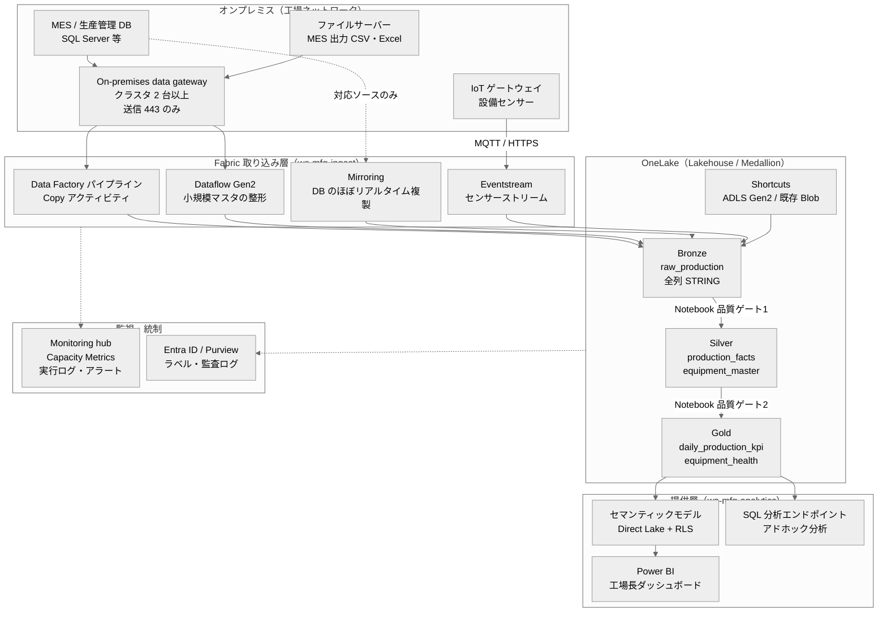
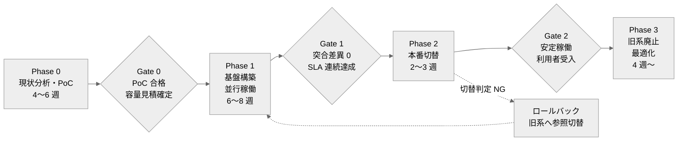
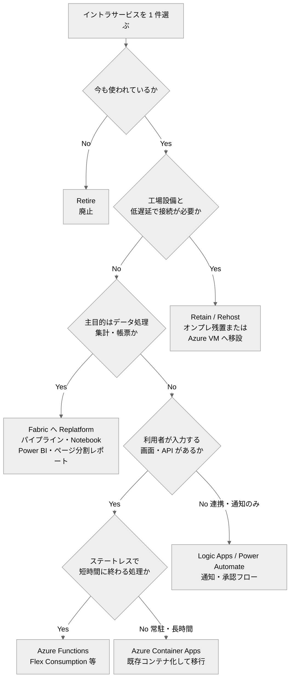

# オンプレミス → Microsoft Fabric 移行設計書 — 製造業データ基盤

| 項目 | 値 |
|------|-----|
| 対象 | オンプレミスの工場システム（MES・生産管理 DB・ファイルサーバー・イントラサービス）を持つ製造業 |
| 具体例 | 本デモ（工場生産実績 ETL: MES CSV → Bronze → Silver → Gold → Power BI） |
| ターゲット | Microsoft Fabric（OneLake / Lakehouse / Data Factory / Power BI）+ 必要に応じて Azure サーバーレス |
| ステータス | 参照設計（リファレンス）。顧客ごとに現状分析の結果で調整する |
| 関連 | `security-entra-id.md`、`02_architecture/architecture.md`、`02_architecture/ADR-001_pipeline-pattern.md` |

> **注記**: Microsoft Fabric は機能追加・名称変更が頻繁である。本書で「（プレビュー機能の可能性あり。採用前に最新状況を確認）」と記した機能は、設計確定前に Microsoft Learn の最新ドキュメントと自テナントの管理ポータルで提供状況を確認すること。

---

## 1. 目的とスコープ

### 1.1 目的

| # | 目的 | 本書での扱い |
|---|------|-------------|
| 1 | 工場データをオンプレミスから Fabric へ移行・統合する | 2〜5 章 |
| 2 | Data Factory パイプラインで ETL を自動化する | 3〜4 章 |
| 3 | 移行を段階的に行い、業務停止とデータ欠損を防ぐ | 5 章 |
| 4 | イントラサービスをクラウド（サーバーレス）へ移す手順を示す | 6 章 |
| 5 | 容量（Capacity）を適正化し、負荷を分散する | 7 章 |
| 6 | リスクを事前に洗い出し、対策を合意する | 8 章 |

### 1.2 スコープ外

| 項目 | 理由 |
|------|------|
| MES・制御系（PLC / SCADA）そのものの置き換え | OT 領域。データ連携のみを対象とする |
| 認証・権限・ネットワークの詳細 | `security-entra-id.md` で扱う |
| 費用見積 | 容量 SKU・リージョン・契約形態で変わるため、サイジング方法のみ示す |

---

## 2. 現状分析チェックリスト

Phase 0 で以下を埋める。空欄が残る項目は「未確定」として移行計画のリスク表（8 章）に載せる。

### 2.1 データソース

| # | 確認項目 | 確認内容 | 本デモでの値 |
|---|---------|---------|-------------|
| 1 | システム名・種別 | MES / ERP / 品質管理 / 設備保全 / IoT / Excel 等 | MES |
| 2 | 格納形式 | RDB（製品・バージョン）/ CSV / Excel / API / ストリーム | CSV（UTF-8 BOM, CRLF） |
| 3 | データ量 | 現在量・日次増分・保持年数 | 500〜1,000 件/日、約 500KB/日 |
| 4 | 増加率 | 新ライン・新製品・センサー追加の予定 | 月 +3% |
| 5 | 更新パターン | 全件洗替 / 差分（更新日時あり）/ 追記のみ / 物理削除の有無 | 全件洗替 |
| 6 | 更新頻度・出力時刻 | 日次・時間・リアルタイム。出力完了の判定方法 | 日次 AM 3:00 |
| 7 | スキーマ安定性 | 列追加・型変更の頻度、変更通知の仕組み | 年 1〜2 回の列追加 |
| 8 | データオーナー | 業務部門・システム担当・連絡先 | 製造部 生産管理課 |
| 9 | 機密区分 | 社外秘 / 個人情報 / 取引先情報の有無 | 社外秘、作業者 ID のみ |
| 10 | 既知の品質問題 | 欠損・重複・コード不統一・手入力の割合 | センサー欠測あり |

### 2.2 インターフェース・既存処理

| # | 確認項目 | 確認内容 |
|---|---------|---------|
| 1 | 連携方式 | ファイル転送（SFTP / 共有フォルダ）、DB リンク、ODBC、API、メッセージキュー |
| 2 | 既存バッチ | タスクスケジューラ、SQL Server エージェント、SSIS、VBA / マクロ、シェル |
| 3 | 依存関係 | ジョブ間の順序、他システムへの戻し連携（逆方向フロー）の有無 |
| 4 | 既存帳票 | Excel 集計、Access、SSRS、紙帳票。利用者数と利用頻度 |
| 5 | 業務 SLA | 「何時までに何が見えればよいか」。現状の実績値 |
| 6 | 障害時運用 | 再実行手順、手作業での補正、問い合わせ窓口 |

### 2.3 イントラサービス（6 章の入力）

| # | 確認項目 | 確認内容 |
|---|---------|---------|
| 1 | サービス一覧 | Web アプリ、ファイル共有、帳票、通知、小規模 API、バッチ |
| 2 | 技術スタック | IIS / .NET / Java / PHP、DB、OS バージョン、サポート期限 |
| 3 | 利用状況 | 月間利用者数、最終アクセス日、業務上の重要度 |
| 4 | 認証方式 | Windows 統合認証（AD）、独自 ID、認証なし |
| 5 | 設備・工場ネットワーク依存 | PLC・設備端末との直結、低遅延要件、工場 LAN 内でしか届かない通信 |
| 6 | 保守体制 | ソースコードの有無、改修できる人の有無、外部委託 |

### 2.4 ネットワーク・基盤制約

| # | 確認項目 | 確認内容 | 設計への影響 |
|---|---------|---------|-------------|
| 1 | インターネット出口 | プロキシの有無、送信 443 の許可、URL フィルタ | ゲートウェイの通信要件を満たせるか |
| 2 | 閉域接続 | ExpressRoute / Site-to-Site VPN の有無 | Private Link を使うか |
| 3 | 工場 LAN の分離 | OT ネットワークと情報系ネットワークの境界（DMZ） | ゲートウェイ配置場所 |
| 4 | 帯域 | 工場拠点の回線帯域、業務時間帯の使用率 | 初期ロードの方式・時間帯 |
| 5 | ID 基盤 | オンプレ AD と Entra ID の同期状況（Entra Connect 等） | SSO・グループ設計 |
| 6 | Azure 利用状況 | 既存サブスクリプション、Key Vault、ガバナンス（ポリシー） | 周辺 Azure リソースの配置 |
| 7 | Microsoft 365 / Power BI 利用状況 | 既存ライセンス、既存ワークスペース | 容量・ライセンス設計 |

---

## 3. ターゲットアーキテクチャ

### 3.1 全体図



<details>
<summary>Mermaid ソース</summary>



</details>

### 3.2 構成要素と役割

| レイヤー | Fabric / Azure の構成要素 | 役割 | 本デモでの対応 |
|---------|-------------------------|------|---------------|
| 接続 | On-premises data gateway（標準モード、クラスタ構成） | 工場内 DB・ファイルへの送信方向のみの接続口 | MES CSV の格納先（共有フォルダ）を読む |
| 取り込み | Data Factory パイプライン（Copy アクティビティ） | 定期バッチでのファイル・テーブル取り込み、全体オーケストレーション | `bronze_ingest` 〜 `semantic_model_refresh` の DAG |
| 取り込み | Dataflow Gen2 | ノーコードでの小規模マスタ整形・取り込み | 設備・ライン・製品マスタ（Excel 管理の場合） |
| 取り込み | Mirroring | 対応 DB のテーブルを OneLake にほぼリアルタイム複製 | 生産管理 DB を移行する場合の選択肢 |
| 取り込み | Eventstream（Real-Time Intelligence） | センサー等のストリームを受信・振り分け | 将来の設備センサー直結（現行は MES 経由） |
| 保存 | OneLake / Lakehouse（Delta 形式） | Medallion 各層の単一ストレージ | `bronze.raw_production` 〜 `gold.*` |
| 保存 | Shortcuts | データを複製せず外部ストレージを参照 | 既存の Blob / ADLS Gen2 に置かれた CSV の参照 |
| 変換 | Notebook（PySpark） | 型変換・品質ゲート・SCD2・集計 | `05_implementation/src/*.py` をそのまま移植 |
| 提供 | セマンティックモデル（Direct Lake）、Power BI | ダッシュボード・RLS | 工場長ダッシュボード |
| 提供 | SQL 分析エンドポイント | T-SQL による読み取り専用分析 | 品質管理担当のアドホック分析 |
| 監視 | Monitoring hub、Capacity Metrics アプリ、実行ログテーブル | 実行状況・容量使用率・業務メトリクス | `meta.pipeline_execution_log`（`07_operations/monitoring-design.md`） |
| 統制 | Entra ID、Microsoft Purview | 認証・認可・ラベル・監査 | `security-entra-id.md` |

### 3.3 設計原則

| # | 原則 | 根拠 |
|---|------|------|
| 1 | Bronze は変換しない。再処理の起点として保持する | `rules/medallion-architecture.md` |
| 2 | すべての書き込みはパーティション上書き（`replaceWhere`）または MERGE で冪等にする | `rules/idempotency-patterns.md`、ADR-001 |
| 3 | 品質ゲートで不合格レコードを削除せず Dead Letter に分離する | `04_quality/quality-design.md` |
| 4 | 取り込み（ETL）と提供（BI）のワークスペースを分ける | 権限分離と容量負荷の分離（7 章） |
| 5 | 移行期間中もオンプレ側を正とし、突合で一致を確認してから切り替える | 5 章 |
| 6 | 処理日はパラメータで注入し、現在時刻に依存しない | `rules/idempotency-patterns.md` 7.3 |

---

## 4. 取り込み方式の比較と選定

### 4.1 比較表

| 観点 | ゲートウェイ + パイプライン Copy | Dataflow Gen2 | Mirroring | Shortcuts | Eventstream |
|------|------------------------------|---------------|-----------|-----------|-------------|
| 主な用途 | 定期バッチの大量コピー、オーケストレーション | ノーコードの整形付き取り込み | DB の継続的な複製 | 複製せずに参照 | ストリーム受信 |
| オンプレ接続 | On-premises data gateway 経由 | On-premises data gateway 経由 | ソース種別により異なる。オンプレ SQL Server 等はゲートウェイ経由の構成（プレビュー機能の可能性あり。採用前に最新状況を確認） | ゲートウェイ経由の S3 互換ストレージ等に限定（プレビュー機能の可能性あり。採用前に最新状況を確認） | エージェント・IoT Hub・Event Hubs 等を経由 |
| 鮮度 | スケジュール間隔（分〜日） | スケジュール間隔 | ほぼリアルタイム | 参照元と同一 | 秒単位 |
| 変換 | なし（Copy）。変換は後段 Notebook | Power Query で可能 | なし（そのまま複製） | なし | 軽微なフィルタ・集約 |
| データ量の目安 | 小〜大 | 小〜中 | 中〜大 | 制約なし（参照のみ） | 継続流入 |
| 冪等性 | パーティション上書きで確保しやすい | 出力先の更新方式に依存 | ソースと同期するため構造的に担保 | 参照元に依存 | 後段で重複排除が必要 |
| 運用難易度 | 低〜中 | 低 | 低（対応ソースなら） | 低 | 中 |
| 容量消費の傾向 | Copy の実行時間に比例 | Power Query の処理が比較的重い | 複製処理そのものは別枠の扱いがある（課金条件は要確認） | ほぼなし（読み取り時のみ） | 常時稼働のため継続的に消費 |

### 4.2 選定ガイド

| 状況 | 推奨方式 | 理由 |
|------|---------|------|
| 工場のファイルサーバーに日次 CSV が出力される（本デモ） | ゲートウェイ + パイプライン Copy → Bronze | 既存の出力をそのまま使え、再実行が容易 |
| CSV が既に Azure Blob / ADLS Gen2 に転送されている | Shortcuts（またはパイプライン Copy） | 二重保存を避ける。Bronze のパーティション管理が必要ならコピー |
| 生産管理 DB を分析用にほぼリアルタイムで見たい | Mirroring（対応ソースの場合） | 差分抽出ロジックの自作が不要 |
| Mirroring 非対応の DB で差分抽出したい | パイプライン Copy + 更新日時による増分（ハイウォーターマーク） | `rules/pipeline-patterns.md` 2.2。物理削除は検出不可のため定期フルリフレッシュを併用 |
| Excel 管理のマスタを業務部門が保守している | Dataflow Gen2 | 業務部門でも保守できる |
| 設備センサーを秒単位で監視したい | Eventstream → Eventhouse（KQL）、集計結果を Lakehouse へ | バッチ系と経路を分け、ダッシュボードの鮮度要件を満たす |
| 大容量の初期ロード（過去数年分） | パイプライン Copy を期間分割して並列実行。回線が細い場合はオフライン転送も検討 | 業務時間帯の帯域を圧迫しない |

### 4.3 本デモへの適用

現行デモの取り込み経路は「SFTP → Azure Blob Storage → Lakehouse Files」である（`01_requirements/requirements.yaml`）。移行設計では次の 2 案を比較し、顧客の既存資産で選ぶ。

| 案 | 経路 | 採用条件 |
|----|------|---------|
| A（ゲートウェイ直結） | ファイルサーバー → On-premises data gateway → パイプライン Copy → Bronze | SFTP・Blob を新たに用意したくない。ゲートウェイ用サーバーを工場側に置ける |
| B（既存転送を活用） | SFTP → Blob / ADLS Gen2 → Shortcut またはパイプライン Copy → Bronze | 既にファイル転送の仕組みがある。工場側にサーバーを増やせない |

いずれの案でも Bronze 以降（Notebook による品質ゲート・Silver・Gold）は共通である。

---

## 5. 段階的移行計画

### 5.1 フェーズ全体像



<details>
<summary>Mermaid ソース</summary>



</details>

### 5.2 フェーズ別の入口・出口基準

| フェーズ | 主な作業 | 入口基準 | 出口基準（ゲート） |
|---------|---------|---------|------------------|
| Phase 0: 現状分析・PoC | 2 章のチェックリスト作成、代表 1 ソースで Bronze〜Gold〜Power BI を試作、ゲートウェイ疎通、容量計測 | スポンサー・データオーナーの合意、検証用テナント・試用容量の確保 | PoC で SLA 内に処理完了、品質ゲートが機能、CU 使用量の実測値から SKU を仮決定、移行対象と優先度の合意 |
| Phase 1: 基盤構築・並行稼働 | 本番ワークスペース・容量・ゲートウェイクラスタ構築、Entra ID グループ・権限設定、全対象ソースのパイプライン実装、旧系と並行稼働して日次突合 | Gate 0 通過、セキュリティ設計（`security-entra-id.md`）の承認 | 突合差異 0 件が連続 N 営業日（推奨: 10 営業日以上かつ月末を 1 回含む）、SLA 連続達成、ランブック整備、利用者向け説明完了 |
| Phase 2: 本番切替 | 利用者の参照先を Power BI に切替、旧帳票を読み取り専用化、ハイパーケア（重点監視） | Gate 1 通過、切替判定会議で Go | 切替後 2 週間の重大障害 0、利用者受入テスト合格、問い合わせが収束 |
| Phase 3: 旧系廃止・最適化 | 旧バッチ停止、旧データのアーカイブ、旧サーバー廃止、容量・スケジュールの最適化 | Gate 2 通過、保管要件（監査・法定保存）の確認 | 旧系の停止完了、アーカイブの復元テスト合格、容量使用率が目標範囲内 |

### 5.3 並行稼働時の突合（Reconciliation）

旧系（オンプレの Excel 集計・帳票・DB）と新系（Fabric Gold）の結果を、処理日ごとに自動で突合する。突合結果は `meta.reconciliation_log`（新設）に記録し、差異があれば WARNING を通知する。

| # | 突合項目 | 粒度 | 許容差 | 突合 SQL / 方法の例 |
|---|---------|------|-------|-------------------|
| 1 | レコード件数 | 生産日 × ライン | 0 件 | Bronze 件数 = ソース件数、Silver + Dead Letter = Bronze |
| 2 | 数量合計 | 生産日 × ライン | 0 | `SUM(actual_quantity)`、`SUM(defect_quantity)`、`SUM(planned_quantity)` |
| 3 | KPI 値 | 生産日 × ライン | 丸め誤差のみ（例: 0.0001） | 不良率・達成率・歩留まり率 |
| 4 | キー集合 | 生産日 | 差集合 0 | 主キー（`production_date + line_id + product_code + shift`）の左右反結合 |
| 5 | 行ハッシュ | 生産日 | 不一致 0 | 業務列を連結した SHA-256 を左右で比較（`rules/idempotency-patterns.md` 4） |
| 6 | Dead Letter 件数 | 生産日 | 旧系の手補正件数と説明可能であること | 旧系で手作業補正していた件数と照合 |

```sql
-- 突合例: 旧系の集計結果（オンプレから日次でコピーした比較用テーブル）と Gold を比較
SELECT
    COALESCE(n.production_date, o.production_date) AS production_date,
    COALESCE(n.line_id, o.line_id)                 AS line_id,
    o.total_actual_quantity  AS legacy_actual,
    n.total_actual_quantity  AS fabric_actual,
    o.total_defect_quantity  AS legacy_defect,
    n.total_defect_quantity  AS fabric_defect
FROM gold.daily_production_kpi AS n
FULL OUTER JOIN recon.legacy_daily_production AS o
    ON  n.production_date = o.production_date
    AND n.line_id         = o.line_id
WHERE n.production_date = '2026-03-10'
  AND (
        n.line_id IS NULL OR o.line_id IS NULL
     OR n.total_actual_quantity <> o.total_actual_quantity
     OR n.total_defect_quantity <> o.total_defect_quantity
  );
-- 0 行であれば合格
```

> 差異が出た場合は「新系のバグ」と決めつけず、旧系の手補正・Excel の数式誤り・締め時刻の違いを先に確認する。旧系の誤りが判明した場合は、データオーナーの承認を得て新系を正とする判断を記録する（ADR 化を推奨）。

### 5.4 ロールバック計画

| 段階 | ロールバックのトリガー | 手順 | 目標時間 |
|------|-------------------|------|---------|
| Phase 1（並行稼働中） | 新系の不具合 | 旧系が正のため利用者影響なし。新系を修正し再実行（冪等設計のため対象日を再処理するだけ） | — |
| Phase 2（切替直後） | 重大障害、SLA 未達が連続、突合で重大差異 | 1) 利用者への案内を旧帳票に戻す 2) 旧バッチの停止を解除（Phase 2 中は停止せず待機させておく） 3) 新系は原因調査 | 1 営業日以内 |
| Phase 2（データ誤り） | Gold / Silver に誤データを書き込んだ | Delta のタイムトラベルで直前バージョンへ `RESTORE`、または対象日を再処理 | 2 時間以内 |
| Phase 3 以降 | 旧系は廃止済み | アーカイブから復元。ロールバックではなく前方修正（Fix Forward）を基本とする | — |

ロールバックを可能にするための前提:

| # | 前提 | 理由 |
|---|------|------|
| 1 | Phase 2 完了まで旧バッチ・旧サーバーを停止しない（読み取り専用化に留める） | 戻り先を確保する |
| 2 | Delta のログ保持期間（`delta.logRetentionDuration`）をロールバック想定期間以上にする | タイムトラベルの範囲を確保する |
| 3 | 切替は「参照先の変更」で行い、データ移動を伴わない | 戻しをリンク変更だけで済ませる |
| 4 | 切替判定会議の判定基準を事前に文書化する | 現場の判断を迷わせない |

---

## 6. イントラサービスのサーバーレス移行手順

工場のイントラサービス（集計バッチ、帳票、ファイル共有、入力フォーム、小規模 API）を、Fabric と Azure のサーバーレスサービスへ移す。**データ処理と帳票は Fabric、利用者が操作するアプリや API は Azure のサーバーレス**、という役割分担を基本とする。

### 6.1 判断フロー



<details>
<summary>Mermaid ソース</summary>



</details>

### 6.2 移行パターンの判断表

| パターン | 定義 | 選ぶ条件 | 避ける条件 |
|---------|------|---------|-----------|
| Retire（廃止） | 使われていないサービスを止める | 最終アクセスが長期間なし、代替機能が Power BI 等で提供される | 法定保存・監査で参照が必要 |
| Retain（残置） | オンプレのまま維持する | 設備と低遅延で直結、OT ネットワーク外に出せない | 保守切れ OS 上で動いている（別途対策が必要） |
| Rehost（移設） | Azure VM 等へそのまま移す | 改修できない（ソースなし・委託先不在）が、オンプレのハードウェアは廃止したい | サーバーレス化の効果を狙う場合（運用負荷が残る） |
| Replatform（基盤載せ替え） | コードは大きく変えず、マネージドサービスに載せる | 集計バッチ → Fabric パイプライン + Notebook、帳票 → Power BI、コンテナ化可能な Web アプリ → Container Apps | 仕様が不明確で、載せ替えても誰も保守できない |
| Refactor（作り直し） | サーバーレス前提で設計し直す | 小さな API・フォームで、改修チームがいる。Functions + マネージド DB で運用負荷を最小化できる | 規模が大きく、移行期間内に作り直せない |
| Repurchase（SaaS 置換） | 市販 SaaS・Microsoft 365 機能に置き換える | 汎用的な申請・承認、文書管理（SharePoint 等）で足りる | 工場固有の業務ロジックが多い |

### 6.3 サービス種別ごとの移行先

| 現行のイントラサービス | 典型的な実装 | 移行先 | パターン | 補足 |
|----------------------|------------|-------|---------|------|
| 日次集計バッチ | タスクスケジューラ + VBA / SQL、SQL Server エージェント | Fabric パイプライン + Notebook | Replatform | 本デモそのもの。処理日をパラメータ化し冪等にする |
| SSIS パッケージ | SQL Server Integration Services | Fabric パイプライン + Dataflow Gen2 / Notebook に再実装。資産が多い場合は Azure Data Factory の SSIS 統合ランタイムで暫定移設 | Replatform / Rehost | Fabric から SSIS を直接実行する機能はプレビュー機能の可能性あり。採用前に最新状況を確認 |
| Excel / Access の集計帳票 | 共有フォルダ上のマクロ付きブック | Power BI レポート（セマンティックモデル + Direct Lake） | Replatform | 計算ロジックを Gold / DAX メジャーに移し、Excel は「Excel で分析」等で接続 |
| 定型帳票（印刷用） | SSRS、Access レポート | Power BI ページ分割レポート | Replatform | 改ページ・印刷レイアウト要件はページ分割レポートで対応 |
| ファイル共有（データ置き場） | Windows ファイルサーバー | 分析データ: OneLake（Lakehouse Files、OneLake ファイルエクスプローラー）。業務文書: SharePoint / OneDrive | Replatform / Repurchase | 分析用データと文書を分けて移す |
| 不良登録などの入力フォーム | IIS + ASP.NET + SQL Server | 小規模: Power Apps または Azure Static Web Apps + Azure Functions。既存コード流用: Azure Container Apps / App Service。DB: Azure SQL Database | Refactor / Replatform | 入力データは Mirroring 対応 DB に置けば分析側への連携が容易（対応状況は要確認） |
| 小規模 API（マスタ参照・連携） | IIS 上の Web API | Azure Functions（HTTP トリガー）+ API Management（必要時） | Refactor | 認証は Entra ID（App Service 認証 / Easy Auth または MSAL）に統一 |
| 通知・承認 | メール送信バッチ、紙の回覧 | Power Automate / Logic Apps、Fabric の Activator（データ条件による通知） | Repurchase / Refactor | 不良率超過アラート等は Activator も候補（提供状況は要確認） |
| 設備直結の収集プログラム | 工場 LAN 上の常駐サービス | 残置（Retain）。送信先のみ Eventstream / IoT Hub に変更 | Retain | OT 側の変更は最小限にする |

### 6.4 移行手順（1 サービスあたり）

| # | ステップ | 作業内容 | 成果物 |
|---|---------|---------|-------|
| 1 | 棚卸し | 2.3 の項目を記入。利用ログで実利用を確認 | サービス台帳 |
| 2 | 判断 | 6.1 のフローと 6.2 の表でパターンと移行先を決定 | 移行方針（重要なものは ADR） |
| 3 | 認証の置き換え | Windows 統合認証 / 独自 ID → Entra ID（SSO）。オンプレ AD とのハイブリッド ID が前提 | アプリ登録、Entra ID グループ |
| 4 | ネットワーク設計 | 社内からのみ利用する場合は Private Endpoint / VNet 統合、条件付きアクセスで社外アクセスを制御。オンプレ DB を参照する場合は VPN / ExpressRoute またはハイブリッド接続 | ネットワーク構成図 |
| 5 | 基盤のコード化 | Bicep / Terraform で Functions・Container Apps・Key Vault 等を定義。Fabric は Git 統合とデプロイパイプラインで dev / test / prod を管理 | IaC リポジトリ |
| 6 | データ移行 | 業務 DB はスキーマ移行 + データコピー。分析データは 4 章の方式で Fabric へ | 移行スクリプト、件数照合結果 |
| 7 | 並行稼働 | 旧サービスと新サービスを並行運用し、出力（帳票・API 応答）を比較 | 比較結果 |
| 8 | 切替 | DNS / リンク / ブックマークの変更、旧サービスを読み取り専用化 | 切替記録 |
| 9 | 監視 | Application Insights（Azure 側）、Monitoring hub（Fabric 側）でエラー率・応答時間を監視 | ダッシュボード、アラート |
| 10 | 廃止 | 旧サーバー停止、ライセンス・保守契約の解約、データのアーカイブ | 廃止報告 |

### 6.5 適用例: 日次生産実績集計（本デモ）

| 項目 | 移行前（典型例） | 移行後 |
|------|----------------|-------|
| 起動 | 工場内 PC のタスクスケジューラ | Fabric パイプラインのスケジュール（AM 4:00） |
| 処理 | Excel マクロで CSV を集計 | Notebook（`extract.py` / `transform.py` / `aggregate.py`） |
| 品質確認 | 担当者の目視 | 品質ゲート 1・2、Dead Letter 分離 |
| 出力 | 共有フォルダの Excel | Gold テーブル + Power BI ダッシュボード |
| 完了時刻 | AM 10:00 過ぎ（`requirements.yaml` の既知課題） | AM 7:00（SLA AM 8:00） |
| 障害対応 | 担当者が手作業でやり直し | ランブック（`07_operations/runbook.md`）に従い対象日を再実行 |
| サーバー | 工場内 PC・ファイルサーバー | 不要（Fabric 容量上で実行） |

---

## 7. 容量設計と負荷分散

### 7.1 Fabric 容量の基本

| 項目 | 内容 | 設計上の意味 |
|------|------|------------|
| 容量単位 | F SKU（F2, F4, F8, … F64 …）。数字が容量単位（CU）数 | 小さく始めて実測で調整する |
| 共有 | 1 容量に複数ワークスペースを割り当て、CU を共有する | 重い処理が同居すると互いに影響する |
| スムージング | 対話型操作は短い時間窓、バックグラウンド処理（パイプライン・Notebook・更新）は 24 時間で平準化して課金・制限判定される | 夜間バッチの瞬間ピークは平準化される一方、超過分は後続の時間帯に繰り越される |
| スロットリング | 平準化後の使用量が一定期間超過し続けると、対話型の遅延 → 対話型の拒否 → バックグラウンドの拒否の順に制限される | 日中のダッシュボードが遅くなる形で表面化する |
| 計測 | Microsoft Fabric Capacity Metrics アプリ | Phase 0 から計測して SKU を決める |
| Power BI 閲覧 | 一定以上の SKU（F64 以上）ではコンテンツ閲覧者に個別の Power BI Pro ライセンスが不要。それ未満では閲覧者にもライセンスが必要 | 閲覧者数とライセンス費用の比較で SKU を判断する（条件は最新のライセンス規定を確認） |
| 一時停止・スケール | 容量は一時停止・SKU 変更が可能（従量課金の場合） | 開発・検証容量は夜間・休日に停止できる |

### 7.2 ワークスペース・容量の分離

| ワークスペース | 内容 | 割り当て容量（小規模） | 割り当て容量（中規模以上） |
|--------------|------|---------------------|------------------------|
| `ws-mfg-ingest-dev` / `-test` | 開発・検証用パイプライン・Lakehouse | 開発用容量（停止可能） | 開発用容量 |
| `ws-mfg-ingest-prod` | 本番パイプライン・Notebook・Lakehouse（Bronze / Silver / Gold） | 本番容量（共通） | ETL 用容量 |
| `ws-mfg-analytics-prod` | セマンティックモデル・レポート・Power BI アプリ | 本番容量（共通） | BI 用容量 |
| `ws-mfg-admin` | 実行ログ・突合結果・監視レポート | 本番容量（共通） | BI 用容量 |

分離の判断基準:

| 状況 | 判断 |
|------|------|
| 夜間バッチのみで日中は BI 中心 | 1 容量で開始。スムージングの範囲で両立できることを Capacity Metrics で確認 |
| 日中にも ETL（マイクロバッチ・Mirroring・Eventstream）が走り、BI の応答が遅れる | ETL 用と BI 用に容量を分ける |
| 工場（拠点）ごとに予算管理したい | 拠点別容量、またはドメインで論理分割し容量は共有 |
| 開発者の試行錯誤が本番に影響する | 開発容量を必ず分ける |

### 7.3 負荷分散の手段

| 対象 | 手段 | 内容 |
|------|------|------|
| ゲートウェイ | ゲートウェイクラスタ（2 台以上） | 高可用性に加え、クラスタ内でクエリを分散する設定を有効化する。メンバーは別ホスト・別電源系統に置く |
| ゲートウェイ | 用途別クラスタ | 大量コピー用とリフレッシュ用を分け、相互干渉を防ぐ（規模が大きい場合） |
| パイプライン | スケジュールの分散 | ソースの出力完了時刻に合わせて開始時刻をずらす。依存関係はパイプライン内の後続実行で表現し、時刻ベースの待ち合わせを避ける |
| パイプライン | 並列度の制御 | ForEach の同時実行数、Copy の並列コピー数をソース DB の負荷許容範囲に合わせる |
| Spark | プール設定・セッション共有 | スタータープール（起動が速い）とカスタムプール（ノードサイズ・最大ノード数を制限）を使い分ける。複数 Notebook はハイコンカレンシーモードでセッションを共有する |
| Spark | 小ファイル対策 | `optimizeWrite` / `autoCompact`、定期 OPTIMIZE（`rules/partitioning.md`） |
| Power BI | Direct Lake | インポート更新の CU 消費と所要時間を削減する。フォールバック（DirectQuery）条件を把握して回避する |
| Power BI | 更新時刻 | セマンティックモデルのフレーミング・更新を ETL 完了直後に 1 回行い、日中の繰り返し更新を避ける |
| ソース DB | 抽出時間帯 | 生産系 DB の負荷が低い時間帯に抽出、または読み取りレプリカ・Mirroring を使う |

### 7.4 SKU サイジング手順

| # | ステップ | 内容 |
|---|---------|------|
| 1 | 代表ワークロードの定義 | 日次バッチ 1 回分、ダッシュボード同時閲覧者数（朝の会議時間帯）、アドホック分析の想定回数 |
| 2 | PoC で実測 | 試用容量または小さな F SKU で実行し、Capacity Metrics アプリで処理ごとの CU 秒を取得 |
| 3 | 将来量で補正 | データ量の増加率（本デモでは月 +3%）、拠点追加、保持年数の増加分を掛ける |
| 4 | 余裕を設定 | 平準化後の使用率が平常時で 60〜70% 程度に収まる SKU を選ぶ（ピーク時の再実行・障害復旧の余地を残す） |
| 5 | 閲覧ライセンスと比較 | 閲覧者数が多い場合、F64 以上と「小さい SKU + 閲覧者分の Pro ライセンス」を比較する |
| 6 | 運用で見直し | 月次で使用率とスロットリング発生有無を確認し、SKU 変更・スケジュール調整を行う |

> 本デモ規模（日次 1,000 件程度）は F2 で処理可能という前提で設計されている（ADR-001）。複数工場・複数ソースへ拡張する場合は上記手順で再計測する。

---

## 8. リスクと対策

| # | リスク | 影響 | 発生可能性 | 対策 |
|---|-------|------|-----------|------|
| 1 | 工場ネットワークから送信 443 が許可されない、またはプロキシで遮断される | ゲートウェイが接続できず取り込み不可 | 中 | Phase 0 で疎通確認。ネットワーク部門と通信要件を早期合意。代替として既存の SFTP → Blob 経路（4.3 案 B） |
| 2 | ゲートウェイサーバーの単一障害 | 日次取り込み停止 | 中 | クラスタ 2 台以上、回復キーを Key Vault で保管、監視対象に追加 |
| 3 | 旧系の暗黙ロジック（手補正・Excel 数式）が新系に反映されない | 突合差異、利用者の不信 | 高 | 並行稼働での日次突合、差異の原因分類、業務部門レビュー |
| 4 | 想定外の容量超過によるスロットリング | ダッシュボードが朝の会議時間に遅延 | 中 | Capacity Metrics での監視、ETL と BI の容量分離、スケジュール分散 |
| 5 | プレビュー機能への依存 | 仕様変更・提供終了で手戻り | 中 | 本番の必須経路にはプレビュー機能を使わない方針。使う場合は代替経路を設計に含める |
| 6 | ソース側のスキーマ変更が通知されない | パイプライン失敗、誤データ | 中 | Bronze 全列 STRING、スキーマ差分検知で停止（`02_architecture/architecture.md` 4.3）、データコントラクト（`04_quality/data-contract.yaml`） |
| 7 | 初期ロードが回線帯域を圧迫 | 工場業務への影響 | 中 | 夜間・休日に期間分割して実施、帯域上限の設定 |
| 8 | 権限設定の誤りによる過剰公開 | 情報漏えい | 低〜中 | `security-entra-id.md` のチェックリスト、グループ単位付与、定期的なアクセスレビュー |
| 9 | 現場の利用定着が進まない | 旧 Excel 運用が残り二重管理 | 中 | 工場長ダッシュボードを早期に見せる、旧帳票の段階的停止、説明会 |
| 10 | 旧系の早期停止によりロールバック不能 | 障害時に業務停止 | 低 | Phase 2 完了まで旧系を待機させる（5.4） |
| 11 | 移行担当者の PySpark スキル不足 | 保守性低下 | 中 | 変換ロジックを関数化しテスト付きで提供（`06_testing/`）、Dataflow Gen2 の併用 |

---

## 9. WBS・タイムライン例（中規模移行）

前提: 工場 2〜3 拠点、主要ソース 5〜10 系統（MES・生産管理 DB・品質・設備保全・マスタ類）、イントラサービス 10〜20 件、移行チーム 4〜6 名。期間は約 5〜6 か月を想定する。

| WBS | 作業 | 期間（週） | 主担当 | 成果物 |
|-----|------|----------|-------|-------|
| 0.1 | キックオフ、体制・役割の確定 | 1 | PM | 体制図、コミュニケーション計画 |
| 0.2 | 現状分析（データソース・イントラサービス・ネットワーク） | 2〜3 | アーキテクト | 2 章チェックリスト、サービス台帳 |
| 0.3 | アーキテクチャ検討、主要 ADR 作成 | 2（0.2 と並行） | アーキテクト | ターゲット構成、ADR |
| 0.4 | PoC（代表 1 ソースで Bronze〜Power BI、ゲートウェイ疎通） | 2〜3 | データエンジニア | PoC 報告、CU 実測値 |
| 0.5 | Gate 0 判定 | — | PM・スポンサー | 判定記録 |
| 1.1 | 本番テナント設定、容量・ワークスペース・ドメイン作成 | 1 | 基盤担当 | 環境定義 |
| 1.2 | Entra ID グループ、権限、条件付きアクセス、テナント設定 | 1〜2 | セキュリティ担当 | 権限マトリクス適用記録 |
| 1.3 | ゲートウェイクラスタ構築、接続（Connections）作成 | 1 | 基盤担当 | ゲートウェイ構成書 |
| 1.4 | パイプライン・Notebook 実装（ソース単位で反復） | 4〜6 | データエンジニア | パイプライン、テスト結果 |
| 1.5 | セマンティックモデル・レポート・RLS 実装 | 3（1.4 と並行） | BI 担当 | レポート、RLS テスト結果 |
| 1.6 | 過去データの初期ロード | 1〜2 | データエンジニア | ロード件数照合 |
| 1.7 | 並行稼働・日次突合 | 2〜4 | データエンジニア・業務部門 | 突合ログ、差異分析 |
| 1.8 | イントラサービス移行（優先度順に反復） | 6〜8（1.4 以降と並行） | アプリ担当 | 移行済みサービス |
| 1.9 | ランブック・監視・アラート整備 | 1〜2 | 運用担当 | ランブック、アラート設定 |
| 1.10 | Gate 1 判定 | — | PM・スポンサー | 判定記録 |
| 2.1 | 利用者説明・トレーニング | 1 | BI 担当 | 説明資料 |
| 2.2 | 本番切替、ハイパーケア | 2 | 全員 | 切替記録、障害記録 |
| 2.3 | Gate 2 判定 | — | PM・スポンサー | 判定記録 |
| 3.1 | 旧バッチ・旧サーバー停止、アーカイブ | 2 | 基盤担当 | 廃止報告 |
| 3.2 | 容量・スケジュール最適化、振り返り | 2 | アーキテクト | 最適化報告、改善 ADR |

```text
月        1        2        3        4        5        6
Phase 0  ████████
Phase 1           ████████████████████
 └ イントラ移行            ████████████████
Phase 2                               ██████
Phase 3                                     ████████
```

---

## 10. 設計時チェックリスト

- [ ] 2 章の現状分析チェックリストに未確定項目が残っていないか（残る場合はリスク表に記載したか）
- [ ] ソースごとに取り込み方式を 4 章の基準で選定し、理由を記録したか
- [ ] 本番必須経路にプレビュー機能を使っていないか（使う場合は代替経路があるか）
- [ ] すべての書き込みが冪等（パーティション上書き / MERGE）か
- [ ] 並行稼働の突合項目・許容差・合格基準（連続営業日数）を合意したか
- [ ] ロールバック手順と、旧系を停止しない期間を合意したか
- [ ] イントラサービスごとに移行パターンを決め、サービス台帳に記録したか
- [ ] ETL と BI のワークスペースを分離し、容量分離の判断基準を決めたか
- [ ] Capacity Metrics アプリで PoC の CU 使用量を計測し、SKU 選定根拠を残したか
- [ ] ゲートウェイをクラスタ構成にし、回復キーの保管場所を決めたか
- [ ] セキュリティ設計（`security-entra-id.md`）のチェックリストを完了したか
- [ ] 重要な判断（取り込み方式、容量分離、移行パターン）を ADR として記録したか

---

## 参照ドキュメント

| ドキュメント | パス |
|-------------|------|
| セキュリティ設計（Entra ID） | `08_fabric/design/security-entra-id.md` |
| 要件定義 | `01_requirements/requirements.yaml` |
| アーキテクチャ設計 | `02_architecture/architecture.md` |
| ADR: パイプラインパターン選択 | `02_architecture/ADR-001_pipeline-pattern.md` |
| スキーマ設計 | `03_schema/schema-design.md` |
| 品質設計 | `04_quality/quality-design.md` |
| 監視設計 | `07_operations/monitoring-design.md` |
| ランブック | `07_operations/runbook.md` |
| ルール | `rules/pipeline-patterns.md`、`rules/medallion-architecture.md`、`rules/idempotency-patterns.md`、`rules/partitioning.md` |
