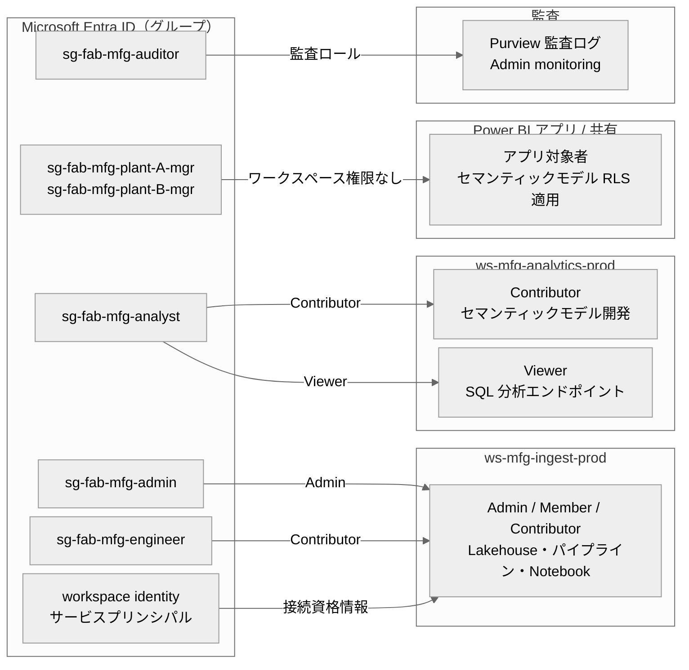
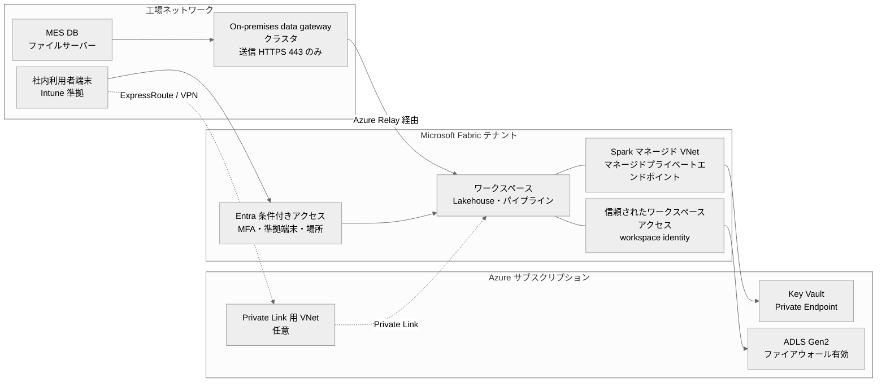

# セキュリティ設計書（Microsoft Entra ID 連携）— 製造業データ基盤 on Microsoft Fabric

| 項目 | 値 |
|------|-----|
| 対象 | オンプレミスの工場システムを Fabric へ移行する製造業のデータ基盤 |
| 具体例 | 本デモ（工場生産実績: Bronze / Silver / Gold、工場長ダッシュボード） |
| 認証基盤 | Microsoft Entra ID（オンプレ AD とハイブリッド ID 構成を想定） |
| ステータス | 参照設計（リファレンス）。顧客のセキュリティ基準に合わせて調整する |
| 関連 | `migration-onprem-to-fabric.md`、`rules/etl-security.md` |

> **注記**: Fabric のセキュリティ機能（OneLake のデータアクセスロール、ワークスペース単位の Private Link、送信アクセス保護、Key Vault 参照など）は提供状況が変わりやすい。「（プレビュー機能の可能性あり。採用前に最新状況を確認）」と記した機能は、設計確定前に Microsoft Learn と自テナントで提供状況を確認すること。テナント設定の名称も変更されることがあるため、管理ポータル上の最新名称で確認する。

---

## 1. 設計方針

| # | 方針 | 内容 |
|---|------|------|
| 1 | ID は Entra ID に一本化 | Fabric・Power BI・Azure・イントラサービス（6 章の移行先）を同一 ID でシングルサインオン |
| 2 | 権限はグループに付与 | 個人に直接権限を付けない。グループ所属で権限を管理し、入退社・異動は Entra ID 側の変更で完結させる |
| 3 | 最小権限 | ワークスペースロールは必要最小限。閲覧者はワークスペースに入れず、アプリ・項目共有で提供する |
| 4 | レイヤーで公開範囲を分ける | Bronze / Silver はデータエンジニアのみ。分析者・業務部門には Gold と セマンティックモデルのみ公開（`rules/etl-security.md` 4） |
| 5 | 行レベルの制限はアクセス経路ごとに | セマンティックモデル RLS は Power BI 経路にのみ効く。SQL 分析エンドポイント・Spark 経路は別途制御する |
| 6 | 人のアカウントでバッチを動かさない | パイプライン・接続の認証は workspace identity / サービスプリンシパル / 専用サービスアカウントを使う |
| 7 | シークレットはコードに書かない | Azure Key Vault と Fabric の接続（Connections）に保管する |
| 8 | すべての操作を追跡可能にする | Microsoft Purview 監査ログ、Entra サインインログ、実行ログテーブルを保管・監視する |

---

## 2. ID モデル

### 2.1 全体像



<details>
<summary>Mermaid ソース</summary>



</details>

### 2.2 Entra ID グループ設計

命名規則: `sg-fab-<ドメイン>-<役割>[-<スコープ>]`。グループは Entra ID のセキュリティグループとし、オンプレ AD から同期する場合は同期元で管理する。

| グループ | 対象者 | 用途 | 所有者（承認者） |
|---------|-------|------|----------------|
| `sg-fab-mfg-admin` | 基盤管理者（2〜3 名） | 本番ワークスペースの管理、ゲートウェイ管理 | 情報システム部門 |
| `sg-fab-mfg-engineer` | データエンジニア | パイプライン・Notebook・Lakehouse の開発・運用 | データ基盤責任者 |
| `sg-fab-mfg-analyst` | 本社の分析担当、品質管理・生産管理のパワーユーザー | Gold 参照、セマンティックモデル・レポート作成 | データ基盤責任者 |
| `sg-fab-mfg-plant-<拠点>-mgr` | 各工場の工場長・課長 | 自工場のダッシュボード閲覧 | 各工場長 |
| `sg-fab-mfg-maintenance` | 設備保全チーム | 設備健全性レポート閲覧 | 保全課長 |
| `sg-fab-mfg-auditor` | 内部監査・情報セキュリティ担当 | 監査ログ・権限設定の閲覧 | 内部監査部門 |
| `sg-fab-mfg-gateway-admin` | ゲートウェイ管理者 | On-premises data gateway の管理 | 情報システム部門 |
| `sg-fab-sp-allowed` | サービスプリンシパル | Fabric API 利用を許可する SP の集合（テナント設定で参照） | 情報システム部門 |
| `sg-fab-creators` | Fabric 項目作成を許可する利用者 | テナント設定「項目作成」「ワークスペース作成」の許可対象 | 情報システム部門 |

運用ルール:

| ルール | 内容 |
|--------|------|
| 特権グループの保護 | `admin` 系グループは Privileged Identity Management（PIM）による一時的な昇格を推奨（Entra ID P2 が必要） |
| アクセスレビュー | 四半期ごとに所有者がメンバーを棚卸し（Entra ID のアクセスレビュー機能、または台帳による確認） |
| 入退社・異動 | 人事イベントと連動してグループから削除。個人への直接付与がないため、削除だけで権限が消える |
| ゲスト | 外部委託先は B2B ゲストとして専用グループに入れ、開発ワークスペースのみに限定 |

---

## 3. ロール・権限マトリクス

### 3.1 前提となる Fabric の権限モデル

| 階層 | 権限 | 要点 |
|------|------|------|
| テナント | Fabric 管理者、テナント設定 | 機能の有効化・制限をセキュリティグループ単位で行う |
| 容量 | 容量管理者、容量への割り当て権限 | ワークスペースを容量に割り当てられる人を限定する |
| ドメイン | ドメイン管理者・共同作成者 | 製造ドメインのワークスペースをまとめ、一部のテナント設定を委任できる |
| ワークスペース | Admin / Member / Contributor / Viewer | Admin・Member・Contributor はワークスペース内の全データに読み書き可能。Viewer は閲覧中心だが SQL 分析エンドポイント経由で読み取り可能 |
| 項目 | 共有時の権限（Read、Lakehouse の「SQL エンドポイントの全データ読み取り（ReadData）」「Spark/OneLake の全データ読み取り（ReadAll）」、セマンティックモデルの Build 等） | ワークスペースに入れずに特定項目だけを公開できる |
| データ（OneLake） | OneLake のデータアクセスロール（フォルダ・テーブル単位） | Spark・OneLake 経路の細粒度制御（プレビュー機能の可能性あり。採用前に最新状況を確認） |
| データ（SQL） | SQL 分析エンドポイント / Warehouse の GRANT / DENY、行レベルセキュリティ（RLS）、列レベルセキュリティ（CLS）、動的データマスク | SQL 経路にのみ効く |
| データ（セマンティックモデル） | RLS（DAX）、オブジェクトレベルセキュリティ（OLS） | Power BI 経路にのみ効く。ワークスペースの Admin / Member / Contributor には適用されない |

> **重要**: セマンティックモデルの RLS は、そのモデルを置いたワークスペースの Admin / Member / Contributor には適用されない。また Lakehouse の ReadAll（Spark / OneLake 経路）を持つ利用者は SQL の RLS を経由しない。**RLS で制限したい利用者には、ワークスペースロールと ReadAll を与えない**ことが前提である。

### 3.2 ワークスペース・Lakehouse 構成

Bronze / Silver / Gold を別々の Lakehouse に分けると、項目共有で「Gold だけ公開」が実現しやすい。

| ワークスペース | 項目 | 内容 |
|--------------|------|------|
| `ws-mfg-ingest-prod` | `lh_bronze`、`lh_silver`、`lh_gold`、パイプライン、Notebook、環境（Environment） | 取り込み・変換。エンジニアのみ |
| `ws-mfg-analytics-prod` | セマンティックモデル（`lh_gold` を参照する Direct Lake）、レポート、Power BI アプリ | 提供。分析者が開発、業務部門はアプリで閲覧 |
| `ws-mfg-admin` | 実行ログ・突合結果・監視レポート | 運用担当・監査 |

### 3.3 役割 × 権限マトリクス（本番環境）

| 役割（グループ） | `ws-mfg-ingest-prod` ロール | `lh_bronze` / `lh_silver` | `lh_gold` | SQL 分析エンドポイント | `ws-mfg-analytics-prod` ロール | セマンティックモデル | RLS 適用 | 監査ログ |
|----------------|--------------------------|--------------------------|-----------|---------------------|-----------------------------|-------------------|---------|---------|
| 基盤管理者 `admin` | Admin | 全権 | 全権 | 全権 | Admin | 全権 | なし | 閲覧可（Fabric 管理者の場合） |
| データエンジニア `engineer` | Contributor | 読み書き | 読み書き | 読み取り | Viewer | Read | なし（全データ） | — |
| 分析担当 `analyst` | なし | アクセス不可 | 項目共有: ReadData（SQL 経路のみ） | Gold のみ読み取り | Contributor | 開発・Build | なし（全工場） | — |
| 工場長 `plant-X-mgr` | なし | アクセス不可 | アクセス不可 | アクセス不可 | なし | アプリ経由で Read | **あり（自工場のラインのみ）** | — |
| 設備保全 `maintenance` | なし | アクセス不可 | アクセス不可 | アクセス不可 | なし | アプリ経由で Read | あり（担当工場の設備のみ） | — |
| 監査 `auditor` | なし | アクセス不可 | アクセス不可 | アクセス不可 | なし | なし | — | Purview 監査ログ閲覧ロール + `ws-mfg-admin` Viewer |
| パイプライン実行 ID（workspace identity / SP） | Contributor | 読み書き | 読み書き | — | Contributor（モデル更新用） | 更新 | — | — |

補足:

| # | 補足 |
|---|------|
| 1 | 開発・検証ワークスペースではエンジニアを Member にしてよいが、本番は Contributor とし、ワークスペース設定の変更は Admin に限る |
| 2 | 分析担当がワークスペースの Contributor であることにより、分析担当にはセマンティックモデル RLS が適用されない。全工場の分析が業務上必要なことを前提とし、そうでない場合はモデル開発用と公開用のワークスペースを分ける |
| 3 | 工場長が「Excel で分析」等を使う場合は Build 権限が必要。Build を与えても RLS は適用される |
| 4 | Silver には作業者 ID（`operator_id`）が含まれるため、分析担当には公開しない。Gold は `unique_operators`（人数）のみで個人を特定しない |

---

## 4. 行レベルセキュリティ（RLS）の実装例

### 4.1 要件

| 項目 | 内容 |
|------|------|
| 要件 | 工場長は自工場のラインのデータのみ閲覧できる |
| 対象 | `gold.daily_production_kpi`、`gold.equipment_health`（いずれも `line_id` を持つ） |
| 追加テーブル | `gold.dim_line`（ライン → 工場の対応表）、`gold.sec_line_access`（利用者 → ラインの対応表。動的 RLS 用） |
| 例 | 工場 A: `LINE-001`〜`LINE-003`、工場 B: `LINE-004`〜`LINE-005`（説明用の割り当て） |

```sql
-- ライン → 工場の対応（Gold に追加するディメンション。Notebook で作成）
CREATE TABLE IF NOT EXISTS gold.dim_line (
    line_id    STRING NOT NULL COMMENT '生産ライン ID',
    plant_id   STRING NOT NULL COMMENT '工場 ID（PLANT-A / PLANT-B）',
    line_name  STRING          COMMENT 'ライン名称'
) USING DELTA;

-- 利用者 → 閲覧可能ライン（動的 RLS 用。人事・組織マスタから日次生成）
CREATE TABLE IF NOT EXISTS gold.sec_line_access (
    user_principal_name STRING NOT NULL COMMENT 'Entra ID の UPN（小文字に正規化）',
    line_id             STRING NOT NULL COMMENT '閲覧可能なライン ID'
) USING DELTA;
```

### 4.2 方式 A: セマンティックモデルの静的ロール（推奨）

工場ごとにロールを作り、ロールのメンバーに Entra ID グループを割り当てる。グループ管理だけで運用でき、DAX がシンプルである。

| ロール名 | テーブル | DAX フィルター式 | メンバー |
|---------|---------|-----------------|---------|
| `Plant-A` | `dim_line` | `[plant_id] = "PLANT-A"` | `sg-fab-mfg-plant-A-mgr` |
| `Plant-B` | `dim_line` | `[plant_id] = "PLANT-B"` | `sg-fab-mfg-plant-B-mgr` |
| `All-Plants` | （フィルターなし） | — | 本社の閲覧専用利用者（必要時） |

モデル上は `dim_line[line_id]` → `daily_production_kpi[line_id]`、`dim_line[line_id]` → `equipment_health[line_id]` を一対多・単方向で結ぶ。`dim_line` のフィルターがファクトに伝播する。

### 4.3 方式 B: セマンティックモデルの動的ロール

ライン単位の細かい割り当てや、工場数が多い場合に使う。ロールは 1 つで、利用者ごとの割り当ては `sec_line_access` テーブルで管理する。

```dax
// ロール: LineAccess / テーブル: dim_line
// sec_line_access とはリレーションを張らず、フィルター式内で参照する（双方向リレーションを避ける）
[line_id]
    IN CALCULATETABLE (
        VALUES ( sec_line_access[line_id] ),
        sec_line_access[user_principal_name] = LOWER ( USERPRINCIPALNAME () )
    )
```

| 留意点 | 内容 |
|-------|------|
| メンバー | ロールのメンバーには `sg-fab-mfg-plant-*-mgr` 等のグループをまとめて割り当てる |
| 対応表の鮮度 | 異動を日次で反映する。対応表の更新漏れは「見えない」側に倒れる（安全側） |
| 対応表の保護 | `sec_line_access` 自体は OLS で利用者から非表示にする |
| テスト | Power BI の「ロールとして表示」で、工場長の UPN を指定して検証する |

### 4.4 方式 C: SQL 分析エンドポイント / Warehouse の RLS

分析担当以外に SQL 経路でのアクセスを許可し、かつ行制限が必要な場合に使う。T-SQL のセキュリティポリシーで述語関数を適用する。

```sql
-- Fabric Warehouse / SQL 分析エンドポイントでの実装例
-- （SQL 分析エンドポイントで参照テーブルを使う述語関数が利用できるかは事前に検証すること）
CREATE SCHEMA sec;
GO

CREATE FUNCTION sec.fn_line_access_predicate (@line_id AS VARCHAR(20))
    RETURNS TABLE
    WITH SCHEMABINDING
AS
    RETURN
        SELECT 1 AS fn_result
        FROM gold.sec_line_access AS a
        WHERE a.line_id = @line_id
          AND a.user_principal_name = LOWER(USER_NAME());
GO

CREATE SECURITY POLICY sec.line_access_policy
    ADD FILTER PREDICATE sec.fn_line_access_predicate(line_id)
        ON gold.daily_production_kpi,
    ADD FILTER PREDICATE sec.fn_line_access_predicate(line_id)
        ON gold.equipment_health
    WITH (STATE = ON);
GO
```

| 留意点 | 内容 |
|-------|------|
| 効く経路 | SQL 分析エンドポイント経由のクエリのみ。Spark / OneLake 直接読み取り（ReadAll 保持者）には効かない |
| Direct Lake との関係 | SQL 分析エンドポイントに RLS / OLS を定義すると、そのエンドポイントを参照する Direct Lake モデルは DirectQuery にフォールバックする挙動がある（最新仕様を確認）。Power BI 経路の行制限はセマンティックモデル側（方式 A / B）で行い、SQL 側 RLS とは役割を分ける |
| 関数の型 | Fabric Warehouse では文字列に `VARCHAR` を使う |
| UPN の取得 | `USER_NAME()` が UPN を返すことを検証環境で確認する |

### 4.5 RLS のテスト観点（不変条件テスト）

| # | 禁止状態 | 検証方法 |
|---|---------|---------|
| 1 | 工場 A の工場長に工場 B のラインが見える | 「ロールとして表示」で件数・ライン一覧を確認。自動テストは XMLA / REST API の DAX クエリで実施 |
| 2 | 対応表に存在しない利用者に全データが見える | 対応表から外した UPN で 0 件になることを確認 |
| 3 | 工場長がワークスペースロールを持っている（RLS がバイパスされる） | ワークスペースのアクセス一覧を定期エクスポートし、`plant-*-mgr` が含まれないことを確認 |
| 4 | 工場長が Lakehouse の ReadAll を持っている | 項目のアクセス一覧を確認 |

---

## 5. サービスプリンシパル・workspace identity・シークレット管理

### 5.1 実行 ID の選択

| 優先度 | 実行 ID | 用途 | 長所 | 短所 |
|-------|--------|------|------|------|
| 1 | workspace identity | ファイアウォール付き ADLS Gen2 への「信頼されたワークスペースアクセス」、対応コネクタの認証 | 資格情報を Fabric が管理し、ローテーション不要 | 対応する接続先・コネクタが限られる（最新状況を確認） |
| 2 | サービスプリンシパル（証明書） | Azure SQL / ADLS / REST API 等への接続、CI/CD からの Fabric API 呼び出し | 個人に依存しない。証明書は秘密の漏えいリスクが低い | 証明書の更新運用が必要 |
| 3 | サービスプリンシパル（クライアントシークレット） | 証明書が使えない接続先 | 設定が簡単 | 有効期限ごとのローテーションが必要 |
| 4 | 専用サービスアカウント（オンプレ AD / DB ユーザー） | ゲートウェイ経由のオンプレ DB・ファイル共有への接続 | オンプレ側の既存権限体系で制御できる | パスワード管理・ローテーションが必要 |
| 避ける | 個人アカウント | — | — | 退職・異動・MFA でバッチが停止する |

> 本番のパイプライン・Notebook のスケジュール実行時の実行 ID は、項目の所有者や最終更新者に依存する場合がある。本番項目の作成・デプロイは専用の管理アカウントまたはサービスプリンシパル（Git 統合・デプロイパイプライン経由）で行う方針とし、実際の実行 ID は検証環境で確認する。

### 5.2 接続ごとの認証設計（本デモ）

| 接続 | 接続方式 | 認証 | 権限 |
|------|---------|------|------|
| MES 出力 CSV（ファイル共有） | On-premises data gateway | 専用サービスアカウント（Windows） | 出力フォルダの読み取りのみ |
| 生産管理 DB（移行対象の場合） | On-premises data gateway | 専用 DB ユーザー（読み取り専用ロール） | 対象テーブルの SELECT のみ |
| 既存 ADLS Gen2（ファイアウォール有効） | 信頼されたワークスペースアクセス / Shortcut | workspace identity | ストレージ BLOB データ閲覧者 |
| Key Vault（Notebook から参照） | マネージドプライベートエンドポイント（必要時） | Notebook 実行者の ID | シークレットの取得のみ |
| セマンティックモデル更新 | パイプラインのアクティビティ | パイプライン実行 ID | `ws-mfg-analytics-prod` の Contributor |
| CI/CD（Fabric REST API） | GitHub Actions / Azure DevOps | サービスプリンシパル（証明書 or フェデレーション資格情報） | 対象ワークスペースの Contributor。テナント設定で `sg-fab-sp-allowed` のみ許可 |

### 5.3 シークレット管理とローテーション

| 対象 | 保管場所 | ローテーション周期（推奨） | 手順 |
|------|---------|------------------------|------|
| ゲートウェイ回復キー | Azure Key Vault | 変更時 | ゲートウェイ再インストール・移設時に必要。Key Vault のアクセスは `gateway-admin` のみ |
| オンプレ用サービスアカウントのパスワード | Azure Key Vault（正本）+ Fabric 接続（利用側） | 90〜180 日（社内基準に従う） | 1) Key Vault に新パスワードを登録 2) AD / DB で変更 3) Fabric の接続（Connections）の資格情報を更新 4) テスト実行。Key Vault 参照を接続に使える場合は 3) を省略できる（プレビュー機能の可能性あり。採用前に最新状況を確認） |
| サービスプリンシパルの証明書 / シークレット | Azure Key Vault | 6〜12 か月（シークレットは短めに） | 新旧を重複期間で併存させて切り替える。有効期限 30 日前に通知（Key Vault のイベント / Azure Monitor） |
| Notebook 内で使う API キー等 | Azure Key Vault | 提供元の規定に従う | コードでは `notebookutils.credentials.getSecret("https://<vault-name>.vault.azure.net/", "<secret-name>")` で取得し、ログに出力しない |

```python
# ✅ GOOD: Notebook でシークレットを Key Vault から取得
api_key = notebookutils.credentials.getSecret(
    "https://<vault-name>.vault.azure.net/", "mes-api-key"
)

# ❌ BAD: Notebook やパイプラインのパラメータに直接記載
api_key = "xxxxxxxx"
```

---

## 6. ネットワークセキュリティ

### 6.1 構成



<details>
<summary>Mermaid ソース</summary>



</details>

### 6.2 On-premises data gateway の配置

| 項目 | 設計 |
|------|------|
| 配置場所 | 情報系ネットワーク（または OT と情報系の間の DMZ）。ソースへの到達性があり、インターネットへの送信が可能な位置 |
| 通信 | 送信方向のみ（受信ポートの開放は不要）。HTTPS 443 で Azure Relay / Service Bus に接続する構成とする。プロキシ経由の場合は許可 URL を事前に登録 |
| 構成 | 2 台以上のクラスタ。別ホスト・別電源系統に配置し、同一バージョンを維持 |
| ホスト | 専用サーバー（ドメインコントローラーやソース DB と同居させない）。OS・ゲートウェイを毎月更新 |
| 実行アカウント | 既定のサービスアカウント、または権限を絞ったドメインアカウント |
| 管理者 | `sg-fab-mfg-gateway-admin` のみ。接続の利用者は接続単位でユーザー / グループを指定 |
| 監視 | ゲートウェイのログ・パフォーマンスカウンタ、ゲートウェイの状態を運用監視に含める |

### 6.3 Fabric 側のネットワーク制御

| 機能 | 用途 | 採用判断 |
|------|------|---------|
| テナントレベルの Private Link | 社内ネットワーク（ExpressRoute / VPN 経由）からのみ Fabric にアクセスさせる。「パブリックインターネットアクセスのブロック」と組み合わせる | 一部機能が利用できなくなる制約がある。影響する機能を確認したうえで、厳格な閉域要件がある場合に採用 |
| ワークスペースレベルの Private Link | 特定ワークスペースのみ閉域化 | プレビュー機能の可能性あり。採用前に最新状況を確認 |
| マネージド仮想ネットワーク + マネージドプライベートエンドポイント | Spark（Notebook）から Key Vault・Azure SQL・ADLS Gen2 などへプライベート接続 | F SKU の容量が必要。Notebook から Azure の PaaS をファイアウォール越しに使う場合に採用 |
| 信頼されたワークスペースアクセス | ファイアウォール有効の ADLS Gen2 に workspace identity で接続（Shortcut・パイプライン） | 既存 ADLS Gen2 を残す場合に採用 |
| 送信アクセス保護 | ワークスペースからの外部送信先を制限し、データ持ち出しを防ぐ | プレビュー機能の可能性あり。採用前に最新状況を確認 |
| VNet データゲートウェイ | Azure VNet 内のデータソース（Private Endpoint 付き Azure SQL 等）への接続 | Azure 側に移した業務 DB を参照する場合に検討 |

### 6.4 条件付きアクセス（Conditional Access）

| ポリシー | 対象 | 条件 | 制御 |
|---------|------|------|------|
| CA-01 MFA 必須 | 全 Fabric 利用者 | すべての場所 | 多要素認証を要求 |
| CA-02 準拠端末 | 全 Fabric 利用者 | 社外ネットワーク | Intune 準拠またはハイブリッド参加済み端末を要求。不可ならブロック |
| CA-03 管理者の強化 | `sg-fab-mfg-admin`、Fabric 管理者 | すべて | フィッシング耐性のある MFA、セッション時間の短縮 |
| CA-04 レガシー認証ブロック | 全利用者 | レガシー認証クライアント | ブロック |
| CA-05 ワークロード ID | サービスプリンシパル | 想定外の IP | ブロック（Workload ID 向けライセンスが必要。採用前に確認） |

> 条件付きアクセスの対象アプリには、Power BI Service に加えて Fabric が内部で利用するサービス（Azure Storage、Azure SQL Database、Azure Data Explorer 等）を含めることが推奨されている。一部のみを対象にすると経路によってポリシーが効かない場合があるため、最新の推奨構成を確認する。

### 6.5 テナント設定（ロックダウン）

| 分類 | 設定（概要） | 推奨値 |
|------|------------|-------|
| 作成 | ワークスペースの作成 | `sg-fab-creators` のみ |
| 作成 | Fabric 項目の作成 | `sg-fab-creators` のみ |
| 共有 | Web に公開（Publish to web） | 無効 |
| 共有 | 外部ゲストユーザーとの共有・ゲストのアクセス | 無効、または指定グループのみ |
| 共有 | 組織全体への共有リンク | 無効 |
| エクスポート | Excel / CSV / PDF / PowerPoint 等へのエクスポート | 必要なグループのみ（エクスポート時は秘密度ラベルを継承させる） |
| エクスポート | Analyze in Excel / XMLA エンドポイント | 分析担当・エンジニアのみ |
| 開発者 | サービスプリンシパルによる Fabric API の利用 | `sg-fab-sp-allowed` のみ |
| 情報保護 | 秘密度ラベルの適用を許可、ラベルの継承 | 有効 |
| 監査 | 監査ログ・使用状況メトリクス | 有効 |
| ネットワーク | Private Link、パブリックインターネットアクセスのブロック | 閉域要件がある場合のみ有効（6.3） |

一部のテナント設定はドメイン管理者・容量管理者に委任できる。委任範囲はドメイン単位で決め、本番ドメインでは委任しない方針を推奨する。

---

## 7. データ保護

### 7.1 データ分類（本デモ）

`rules/etl-security.md` 2 章の分類に従う。

| データ | 列の例 | 分類 | 保護措置 |
|-------|-------|------|---------|
| 生産実績・KPI | 数量、不良率、達成率 | 内部（社外秘） | アクセス制限、秘密度ラベル「社外秘」 |
| 設備センサー値 | 温度、振動 | 内部（社外秘） | アクセス制限 |
| 作業者 ID | `operator_id` | 内部（社員 ID 相当） | Bronze / Silver のみに保持し、エンジニアに限定。Gold は人数の集計値のみ |
| 作業者の氏名・連絡先（将来、人事データと結合する場合） | 氏名、メールアドレス | 機密（PII） | マスキング + アクセス制限 + 監査ログ。SQL 経路は動的データマスク / CLS、セマンティックモデルは OLS |
| 取引先・原価情報（将来追加の可能性） | 単価、仕入先 | 機密 | 秘密度ラベル「機密」、アクセス制限 |

### 7.2 秘密度ラベル（Microsoft Purview Information Protection）

| 項目 | 設計 |
|------|------|
| ラベル体系 | 社内の既存ラベル（公開 / 社内 / 社外秘 / 機密 等）をそのまま使う |
| 既定ラベル | 製造ドメインのワークスペースでは「社外秘」を既定とする |
| 継承 | Lakehouse → セマンティックモデル → レポートへの下流継承、エクスポートしたファイルへのラベル付与を有効化 |
| 必須ラベル | 公開用ワークスペースでは、ラベルなしの公開を禁止（必須ラベルポリシー） |
| DLP | Fabric / Power BI 向けのデータ損失防止ポリシーで機密情報の検出・通知を行う（対象項目の種類と提供状況を確認） |
| カタログ | Microsoft Purview（Data Map / Unified Catalog）で Fabric をスキャンし、リネージと分類を可視化 |

### 7.3 暗号化

| 区分 | 内容 |
|------|------|
| 保管時 | OneLake のデータは既定で Microsoft 管理キーにより暗号化される。顧客管理キー（CMK）が必要な場合はワークスペース単位の CMK 機能を確認（プレビュー機能の可能性あり。採用前に最新状況を確認） |
| 転送時 | Fabric への通信は TLS。ゲートウェイ ↔ ソース DB 間も暗号化接続（SQL Server の暗号化接続等）を有効にする |
| 非本番環境 | 本番データを開発・検証に使う場合は静的マスキング（`rules/etl-security.md` 1 章）を適用してからコピーする |

---

## 8. 監査ログ・監視

### 8.1 ログの種類と保管

| ログ | 取得元 | 内容 | 保管・活用 |
|------|-------|------|-----------|
| Fabric / Power BI のアクティビティ | Microsoft Purview 監査ログ（統合監査ログ） | 閲覧、共有、エクスポート、権限変更、項目の作成・削除 | 保持期間はライセンスに依存。長期保管が必要な場合は API（Office 365 管理アクティビティ API 等）で日次エクスポートし、Lakehouse または Log Analytics に保存 |
| テナント全体の利用状況 | 管理者監視ワークスペース（Admin monitoring） | 機能の利用状況・導入状況 | Fabric 管理者が月次レビュー |
| サインイン・条件付きアクセス | Entra ID サインインログ | 認証成功・失敗、CA の適用結果 | Log Analytics / Microsoft Sentinel に転送 |
| 容量 | Capacity Metrics アプリ | CU 使用率、スロットリング | 運用担当が日次確認（`migration-onprem-to-fabric.md` 7 章） |
| パイプライン実行 | Monitoring hub、`meta.pipeline_execution_log` | 実行結果、件数、エラー率 | `07_operations/monitoring-design.md` に従う |
| ゲートウェイ | ゲートウェイのログ | 接続エラー、クエリ実行 | ゲートウェイ管理者が障害時に確認 |

### 8.2 監視・アラートの対象

| # | 検知対象 | 重要度 | 通知先 |
|---|---------|-------|-------|
| 1 | 本番ワークスペースへのロール付与・変更 | WARNING | 基盤管理者、監査 |
| 2 | 外部ユーザーへの共有、組織外への共有リンク作成 | CRITICAL | 情報セキュリティ担当 |
| 3 | 短時間での大量エクスポート | WARNING | 情報セキュリティ担当 |
| 4 | テナント設定の変更 | WARNING | Fabric 管理者、監査 |
| 5 | サービスプリンシパルの資格情報の期限接近（30 日前） | WARNING | 基盤管理者 |
| 6 | 管理者アカウントのサインイン失敗の連続 | CRITICAL | 情報セキュリティ担当 |
| 7 | ゲートウェイのオフライン | CRITICAL | ゲートウェイ管理者（データ取り込み停止に直結） |
| 8 | RLS 対象者（`plant-*-mgr`）がワークスペースロールに追加された | CRITICAL | 基盤管理者（RLS バイパスの防止） |

---

## 9. 設計時チェックリスト

### ID・権限

- [ ] 権限はすべて Entra ID グループに付与し、個人への直接付与がないか
- [ ] 各グループに所有者（承認者）を決め、四半期のアクセスレビューを計画したか
- [ ] 本番ワークスペースの Admin を最小人数にしたか（PIM の利用を検討したか）
- [ ] Bronze / Silver をエンジニアのみに限定し、分析者には Gold のみを公開したか
- [ ] RLS 対象者にワークスペースロールと ReadAll を与えていないか
- [ ] セマンティックモデル RLS を「ロールとして表示」と自動テストで検証したか
- [ ] SQL 経路を公開する場合、SQL 側の RLS / CLS を定義し、Direct Lake への影響を確認したか

### 実行 ID・シークレット

- [ ] パイプライン・接続に個人アカウントを使っていないか
- [ ] workspace identity → サービスプリンシパル（証明書）→ シークレットの優先順で選定したか
- [ ] シークレットを Key Vault で管理し、コード・パラメータに記載していないか
- [ ] ローテーション周期と手順、期限切れ通知を設定したか
- [ ] ゲートウェイ回復キーを Key Vault に保管したか

### ネットワーク

- [ ] ゲートウェイを 2 台以上のクラスタにし、送信 443 のみで疎通を確認したか
- [ ] 閉域要件の有無を確認し、Private Link 採用時の機能制約を評価したか
- [ ] Notebook から Azure PaaS への接続にマネージドプライベートエンドポイントが必要か判断したか
- [ ] 条件付きアクセス（MFA・準拠端末・レガシー認証ブロック）を適用し、対象アプリの範囲を確認したか
- [ ] テナント設定（Web に公開、外部共有、エクスポート、SP の API 利用）を制限したか

### データ保護・監査

- [ ] データ分類（`rules/etl-security.md`）に基づき、PII 列と保護措置を決めたか
- [ ] 秘密度ラベルの既定値・継承・必須化を設定したか
- [ ] 非本番環境に本番データをコピーする場合のマスキングルールを決めたか
- [ ] 監査ログの保持期間を確認し、長期保管のためのエクスポートを設計したか
- [ ] 8.2 の監視・アラートを設定したか
- [ ] 重要なセキュリティ判断（Private Link 採否、RLS 方式、実行 ID）を ADR として記録したか

---

## 参照ドキュメント

| ドキュメント | パス |
|-------------|------|
| 移行設計 | `08_fabric/design/migration-onprem-to-fabric.md` |
| 要件定義 | `01_requirements/requirements.yaml` |
| アーキテクチャ設計 | `02_architecture/architecture.md` |
| スキーマ設計 | `03_schema/schema-design.md` |
| 監視設計 | `07_operations/monitoring-design.md` |
| ルール | `rules/etl-security.md`、`rules/medallion-architecture.md` |
