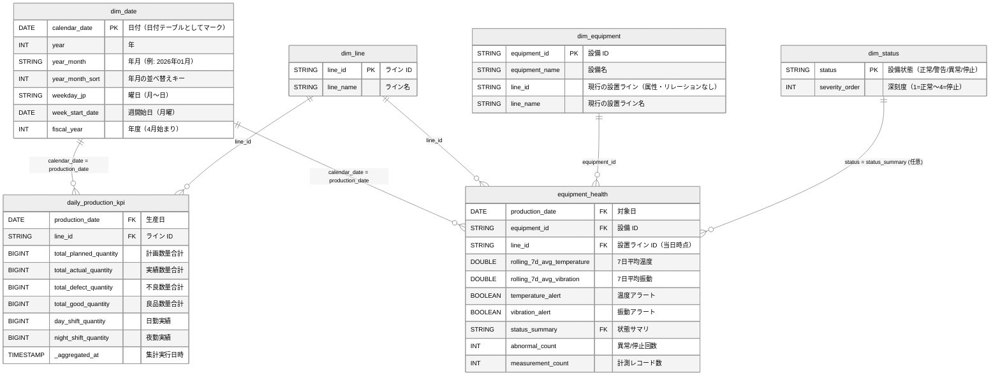

# セマンティックモデル設計 — 製造業 IoT デモ（Direct Lake）

| 項目 | 値 |
|------|-----|
| 対象 | Power BI セマンティックモデル（工場長ダッシュボード用） |
| ストレージモード | Direct Lake（Fabric Lakehouse の Delta テーブルを直接参照） |
| モデル形状 | Star Schema（ファクト 2 + 共通ディメンション 3〜4） |
| 前提データ | `03_schema/ddl/gold.sql` の Gold テーブル、マスタ CSV 3 種 |
| 関連 | `dax-measures.md`（メジャー定義）、`dashboard-spec.md`（レポート仕様） |

---

## 1. 設計方針

| 方針 | 決定 | 理由 |
|------|------|------|
| ストレージモード | Direct Lake | Gold テーブルをインポート更新なしで参照できる。パイプライン完了 = ダッシュボード更新となり、AM 8:00 SLA と整合する |
| ディメンションの作成場所 | Lakehouse の Delta テーブルとして作成する | Direct Lake では計算テーブル・計算列に制約がある（2 章）。日付テーブルもモデル内 DAX ではなく Lakehouse 側で作る |
| 比率の扱い | Gold の事前計算比率列（`achievement_rate` 等）は非表示にし、メジャーで合計から再計算する | 行比率の平均は誤った集計値になる（`dax-measures.md` 1 章） |
| リレーション | すべて多対一・単方向（ディメンション → ファクト） | 双方向フィルターによるあいまいなパスを作らない |
| 設備とラインの関係 | `dim_equipment` と `dim_line` の間にリレーションを張らない | `equipment_health` が `line_id` を持つため、張るとフィルターパスが 2 本になりあいまいになる |
| SQL ビュー | 使わない（Delta テーブルのみ） | SQL 分析エンドポイント経由の Direct Lake ではビュー参照時に DirectQuery へフォールバックし性能が落ちる |
| セマンティックモデル | Lakehouse から「新しいセマンティック モデル」で明示的に作成する | 自動生成の既定モデルは使わない。テーブル選択・メジャー・書式をこのモデルで一元管理する |

---

## 2. Direct Lake の制約と対応

| 制約 | 内容 | 本設計での対応 |
|------|------|---------------|
| 計算テーブル | Direct Lake テーブルを参照する計算テーブルは作れない。`CALENDAR` などの DAX 計算テーブルを混在させると Direct Lake 単独の構成ではなくなる | 日付テーブル `dim_date` を Notebook で Lakehouse に作成する（4 章） |
| 計算列 | Direct Lake テーブルに計算列を追加できない | 並べ替えキー・曜日名・ライン名の非正規化などはすべて Lakehouse 側で列として持たせる |
| SQL ビュー | ビューは Delta テーブルではないため Direct Lake で読めず DirectQuery にフォールバックする | ビューを作らず、テーブルとして書き出す |
| リレーションのキー型 | 両側の列のデータ型が一致している必要がある | 日付キーは両側 `DATE`、文字キーは両側 `STRING` で揃える |
| 一側キーの一意性 | 一側（ディメンション）に重複キーがあるとクエリエラーになる | ディメンション作成時に一意性を検証してから書き込む（4 章のスニペット） |
| データの鮮度 | Delta テーブルの更新はフレーミングで反映される | モデル設定「Direct Lake データを最新の状態に保つ」を有効にする（既定で有効） |

本デモのデータ量は 1 日数百〜千行・Gold は数千行規模であり、F2 容量の Direct Lake ガードレール（テーブル行数上限など）に対して十分小さい。

---

## 3. テーブル構成

### 3.1 テーブル一覧

| モデル上の名前 | 種別 | Lakehouse テーブル | 粒度 | 作成元 |
|---------------|------|-------------------|------|--------|
| `daily_production_kpi` | ファクト | `gold.daily_production_kpi` | 生産日 × ライン | ETL パイプライン（Gold） |
| `equipment_health` | ファクト | `gold.equipment_health` | 対象日 × 設備 | ETL パイプライン（Gold） |
| `dim_date` | ディメンション | `gold.dim_date` | 日 | 4.1 のスニペット |
| `dim_line` | ディメンション | `gold.dim_line` | ライン | `line_master.csv`（4.2） |
| `dim_equipment` | ディメンション | `gold.dim_equipment` | 設備 | `equipment_master_seed.csv` + `line_master.csv`（4.2） |
| `dim_status` | ディメンション（任意） | `gold.dim_status` | 設備状態 | 4.3 の SQL |
| `production_facts` | 明細ファクト（任意） | `silver.production_facts` | 生産レコード | ETL パイプライン（Silver）。7 章参照 |

- モデル上のテーブル名・列名は Lakehouse の物理名のまま使う。`dax-measures.md` の DAX はこの名前を前提にしている
- 表示名を日本語にしたい場合は、メジャーをすべて貼り付けた**後**に列の表示名を変更する（既存メジャーの参照は自動追従する）
- スキーマ未対応の Lakehouse を使う場合、テーブル名は `gold.` を付けない名前になる（モデル上の名前は同じでよい）

### 3.2 前提とするマスタ CSV の列

マスタ CSV は Fabric 配置ガイド（`../deploy-guide.md`）で Lakehouse の `Files/` 配下にアップロードされる前提とする。本設計が**必須とする列**は次のとおり。これ以外の列はそのままディメンションに引き継ぐ。

| ファイル | 必須列 | 一意キー | 用途 |
|---------|--------|---------|------|
| `line_master.csv` | `line_id`, `line_name`, `plant_id`, `plant_name` | `line_id` | `dim_line` |
| `equipment_master_seed.csv` | `equipment_id`, `equipment_name`, `line_id` | `equipment_id` | `dim_equipment` |
| `product_master.csv` | `product_code`, `product_name`, `category` | `product_code` | `dim_product`（7 章の明細ファクトを使う場合のみ） |

Gold の 2 テーブルはいずれも `product_code` を持たないため、`dim_product` は Gold だけの構成では使わない。

### 3.3 ファクト列の表示設定

| テーブル | 列 | 表示 | 理由 |
|---------|-----|------|------|
| 両ファクト | `production_date`, `line_id`, `equipment_id` | 非表示 | 外部キー。スライサー・軸にはディメンション側の列を使う |
| `daily_production_kpi` | `achievement_rate`, `defect_rate`, `yield_rate` | 非表示 | 事前計算比率。暗黙の集計（平均・合計）で誤用されるのを防ぐ |
| `daily_production_kpi` | `total_*_quantity`, `*_shift_quantity` | 非表示 | メジャー（`計画数` 等）経由で使う |
| `equipment_health` | 数値列すべて | 非表示 | メジャー経由で使う |
| `equipment_health` | `status_summary` | 表示 | 設備一覧テーブルで状態を文字列表示する |
| 両ファクト | `_aggregated_at` | 非表示 | データ鮮度メジャー（`最終集計日時`）経由で使う |
| 両ファクト | `record_count`, `unique_products`, `unique_operators` | 非表示 | 本ダッシュボードでは未使用 |

あわせてモデルのプロパティで「暗黙的なメジャーを抑止する」を有効にし、数値列のドラッグによる自動集計を禁止する。

---

## 4. ディメンションの作成（Lakehouse 側）

Notebook（PySpark）で実行する。いずれも `overwrite` で書き込むため、何度再実行しても同じ結果になる（冪等）。

### 4.1 日付テーブル `dim_date`

範囲は Gold の生産日の最小〜最大を含む暦年全体とする。データ範囲から導出するため、サンプルデータの日付が変わっても修正不要である。

```python
from pyspark.sql import functions as F

DIM_DATE_TABLE = "gold.dim_date"
SOURCE_TABLE = "gold.daily_production_kpi"

bounds = spark.sql(
    f"SELECT MIN(production_date) AS min_d, MAX(production_date) AS max_d FROM {SOURCE_TABLE}"
).first()
if bounds is None or bounds.min_d is None:
    raise ValueError(f"{SOURCE_TABLE} が空のため dim_date の範囲を決定できない")

start_date = f"{bounds.min_d.year}-01-01"
end_date = f"{bounds.max_d.year}-12-31"

dim_date = spark.sql(f"""
    SELECT
        d                                                         AS calendar_date,
        year(d)                                                   AS year,
        quarter(d)                                                AS quarter,
        month(d)                                                  AS month,
        concat(CAST(year(d) AS STRING), '年',
               lpad(CAST(month(d) AS STRING), 2, '0'), '月')      AS year_month,
        year(d) * 100 + month(d)                                  AS year_month_sort,
        day(d)                                                    AS day_of_month,
        weekday(d) + 1                                            AS weekday_no,
        element_at(array('月','火','水','木','金','土','日'), weekday(d) + 1) AS weekday_jp,
        weekday(d) >= 5                                           AS is_weekend,
        date_sub(d, weekday(d))                                   AS week_start_date,
        CASE WHEN month(d) >= 4 THEN year(d) ELSE year(d) - 1 END AS fiscal_year
    FROM (
        SELECT explode(sequence(DATE'{start_date}', DATE'{end_date}', INTERVAL 1 DAY)) AS d
    )
""")

(
    dim_date.write
    .format("delta")
    .mode("overwrite")
    .option("overwriteSchema", "true")
    .saveAsTable(DIM_DATE_TABLE)
)
print({"event": "dim_date_written", "table": DIM_DATE_TABLE,
       "start": start_date, "end": end_date, "rows": dim_date.count()})
```

| 列 | 型 | 説明 | モデルでの設定 |
|----|-----|------|---------------|
| `calendar_date` | DATE | 日付（キー） | **日付テーブルとしてマーク**の日付列に指定 |
| `year` / `quarter` / `month` | INT | 年・四半期・月 | 集計を「なし」に設定 |
| `year_month` | STRING | 年月ラベル（`2026年01月`） | 並べ替え列 = `year_month_sort` |
| `year_month_sort` | INT | 年月の並べ替えキー | 非表示 |
| `day_of_month` | INT | 日 | 集計を「なし」に設定 |
| `weekday_no` | INT | 曜日番号（1 = 月曜） | 非表示 |
| `weekday_jp` | STRING | 曜日（月〜日） | 並べ替え列 = `weekday_no` |
| `is_weekend` | BOOLEAN | 土日フラグ | — |
| `week_start_date` | DATE | 週開始日（月曜） | 週次集計の軸に使う |
| `fiscal_year` | INT | 年度（4 月始まり） | 集計を「なし」に設定 |

**日付テーブルとしてマークする理由:** `DATEADD` / `DATESINPERIOD` などのタイムインテリジェンス関数は、連続した日付を持つ日付テーブルを前提とする。マークすると、日付列にフィルターをかけた際に `dim_date` の他の列（年月など）のフィルターも自動的に外れ、移動平均や前日比が正しく計算される。

### 4.2 ライン・設備ディメンション `dim_line` / `dim_equipment`

`MASTER_DIR` は配置ガイドで CSV をアップロードしたフォルダに合わせる。配置ガイドの Notebook が既にマスタをテーブル化している場合は、そのテーブルを読み込み元に差し替える。

```python
from pyspark.sql import DataFrame
from pyspark.sql import functions as F

MASTER_DIR = "Files/sample_data"  # deploy-guide.md の配置先に合わせる


def load_master_csv(file_name: str, required: list[str]) -> DataFrame:
    """マスタ CSV を読み込み、BOM 除去・必須列チェック・キー列の trim を行う。"""
    path = f"{MASTER_DIR}/{file_name}"
    raw = spark.read.option("header", "true").option("encoding", "UTF-8").csv(path)
    df = raw.toDF(*[c.replace("", "").strip() for c in raw.columns])
    missing = [c for c in required if c not in df.columns]
    if missing:
        raise ValueError(f"{path} に必須列がない: {missing}")
    return df.select(
        *[F.trim(F.col(c)).alias(c) if c in required else F.col(c) for c in df.columns]
    )


def assert_unique(df: DataFrame, key: str, name: str) -> None:
    """一側キーの一意性を検証する（重複があると Direct Lake のリレーションでエラーになる）。"""
    total = df.count()
    distinct = df.select(key).distinct().count()
    null_keys = df.filter(F.col(key).isNull()).count()
    if total != distinct or null_keys > 0:
        raise ValueError(f"{name}.{key} が一意でない: rows={total}, distinct={distinct}, null={null_keys}")


def write_dim(df: DataFrame, table: str) -> None:
    df.write.format("delta").mode("overwrite").option("overwriteSchema", "true").saveAsTable(table)
    print({"event": "dim_written", "table": table, "rows": df.count()})


# plant_id / plant_name は RLS（design/security-entra-id.md）で工場単位に絞るために使う
dim_line = load_master_csv("line_master.csv", ["line_id", "line_name", "plant_id", "plant_name"])
assert_unique(dim_line, "line_id", "dim_line")

equipment = load_master_csv("equipment_master_seed.csv", ["equipment_id", "equipment_name", "line_id"])
dim_equipment = equipment.join(
    dim_line.select("line_id", "line_name"), on="line_id", how="left"
)
assert_unique(dim_equipment, "equipment_id", "dim_equipment")

write_dim(dim_line, "gold.dim_line")
write_dim(dim_equipment, "gold.dim_equipment")
```

`dim_equipment.line_id` / `line_name` は**現行の設置ライン**を表す属性であり、リレーションには使わない。ライン別の設備分析は、当日時点の設置ラインを持つ `equipment_health.line_id` → `dim_line` のリレーションで行う（設備移設があっても過去日の集計が正しくなる）。

### 4.3 設備状態ディメンション `dim_status`（任意）

状態を深刻度順に並べたい場合に作成する。値は DDL の CHECK 制約（`正常/警告/異常/停止`）に合わせる。

```sql
CREATE OR REPLACE TABLE gold.dim_status AS
SELECT * FROM VALUES
    ('正常', 1),
    ('警告', 2),
    ('異常', 3),
    ('停止', 4)
AS t(status, severity_order);
```

モデルでは `dim_status[status]` の並べ替え列を `severity_order` に設定する。

### 4.4 参照整合性チェック

ファクトのキーがディメンションに存在しないと、ビジュアルに「(空白)」行が出る。ディメンション作成後に次のクエリで 0 件であることを確認する。

```sql
SELECT 'daily_production_kpi.line_id' AS fk, COUNT(*) AS orphan_rows
FROM gold.daily_production_kpi f LEFT ANTI JOIN gold.dim_line d ON f.line_id = d.line_id
UNION ALL
SELECT 'equipment_health.line_id', COUNT(*)
FROM gold.equipment_health f LEFT ANTI JOIN gold.dim_line d ON f.line_id = d.line_id
UNION ALL
SELECT 'equipment_health.equipment_id', COUNT(*)
FROM gold.equipment_health f LEFT ANTI JOIN gold.dim_equipment d ON f.equipment_id = d.equipment_id
UNION ALL
SELECT 'daily_production_kpi.production_date', COUNT(*)
FROM gold.daily_production_kpi f LEFT ANTI JOIN gold.dim_date d ON f.production_date = d.calendar_date;
```

---

## 5. リレーション

| # | 多側（ファクト） | 一側（ディメンション） | カーディナリティ | クロスフィルター | アクティブ |
|---|----------------|---------------------|----------------|----------------|-----------|
| 1 | `daily_production_kpi[production_date]` | `dim_date[calendar_date]` | 多対一 | 単一 | ○ |
| 2 | `daily_production_kpi[line_id]` | `dim_line[line_id]` | 多対一 | 単一 | ○ |
| 3 | `equipment_health[production_date]` | `dim_date[calendar_date]` | 多対一 | 単一 | ○ |
| 4 | `equipment_health[line_id]` | `dim_line[line_id]` | 多対一 | 単一 | ○ |
| 5 | `equipment_health[equipment_id]` | `dim_equipment[equipment_id]` | 多対一 | 単一 | ○ |
| 6 | `equipment_health[status_summary]` | `dim_status[status]` | 多対一 | 単一 | ○（任意） |

- `dim_date` と `dim_line` は 2 つのファクトで共有する共通ディメンションである。ページをまたいで同じ期間・ラインのスライサーを同期できる
- 設備スライサーは `equipment_health` だけを絞り込む。生産 KPI はライン粒度のため、設備で絞り込めないのは仕様どおりである
- 2 つのファクト間に直接のリレーションは張らない



<details>
<summary>Mermaid ソース</summary>



ソースファイル: `diagrams/semantic-model.mmd`。SVG 再生成: `npx mmdc -i diagrams/semantic-model.mmd -o diagrams/semantic-model.svg -t neutral -b transparent`

</details>

---

## 6. Fabric GUI での構築手順（要約）

| # | 操作 | 補足 |
|---|------|------|
| 1 | Notebook で 4.1〜4.3 を実行し、4.4 のチェックが 0 件であることを確認する | Gold テーブルが先に作成済みであること |
| 2 | Lakehouse →「新しいセマンティック モデル」→ 3.1 のテーブルを選択する | 名前例: `工場生産ダッシュボード` |
| 3 | モデル ビューで 5 章のリレーションを作成する | 自動検出されたリレーションは一度確認し、不要なものは削除する |
| 4 | `dim_date` を「日付テーブルとしてマーク」し、日付列に `calendar_date` を指定する | タイムインテリジェンスの前提 |
| 5 | 3.3 の列を非表示にし、並べ替え列（`year_month` → `year_month_sort` など）を設定する | — |
| 6 | 「暗黙的なメジャーを抑止する」を有効にする | 比率の誤集計を防ぐ |
| 7 | `dax-measures.md` のメジャーを作成し、書式・表示フォルダーを設定する | `dax-measures.dax` で一括追加も可 |
| 8 | `dashboard-spec.md` に沿ってレポートを作成する | — |

---

## 7. 拡張: 明細ファクト `production_facts`（任意）

要件の既知課題「不良品の原因分析にライン・設備・作業者の相関が見えていない」に応えるには、品目・作業者の粒度が必要になる。Gold には品目列がないため、Silver の `production_facts` を明細ファクトとして追加する。

| 項目 | 内容 |
|------|------|
| 追加テーブル | `silver.production_facts`（明細ファクト）、`gold.dim_product`（`product_master.csv` から 4.2 と同じ手順で作成） |
| リレーション | `production_facts[production_date]` → `dim_date`、`[line_id]` → `dim_line`、`[equipment_id]` → `dim_equipment`、`[product_code]` → `dim_product`（いずれも多対一・単一） |
| 列の表示設定 | 数値列・事前計算比率列（`achievement_rate`, `defect_rate`）は非表示。`operator_id`, `shift` は表示 |
| 追加メジャー | `dax-measures.md` 6 章（`不良率（明細）` など） |
| データ量 | 1 日 500〜1,000 行 × 3 年で約 100 万行。Direct Lake で問題ない規模 |

明細と Gold の値は同じ Silver から集計されるため、ライン × 日の合計は一致する。一致しない場合はパイプラインの再実行漏れを疑う。

---

## 8. 前提条件と既知の差異

### 8.1 Gold 列名の前提

本モデルと DAX は `03_schema/ddl/gold.sql` の列名を前提とする。`05_implementation/src/aggregate.py` は現時点で一部の列名・列構成が DDL と異なるため、Fabric 上の Gold テーブルが DDL どおりに作成されていることを確認する。

| テーブル | DDL の列（本モデルが使う名前） | `aggregate.py` の現在の出力 |
|---------|------------------------------|---------------------------|
| `daily_production_kpi` | `total_planned_quantity` / `total_actual_quantity` / `total_defect_quantity` / `total_good_quantity` | `total_planned` / `total_actual` / `total_defect` / `total_good` |
| `daily_production_kpi` | `day_shift_quantity` / `night_shift_quantity` | `day_shift_actual` / `night_shift_actual` |
| `daily_production_kpi` | `yield_rate`, `unique_products`, `unique_operators` | なし |
| `daily_production_kpi` / `equipment_health` | `_aggregated_at` | `calculated_at` |
| `equipment_health` | `line_id` | なし |
| `equipment_health` | `daily_avg_temperature` / `daily_max_temperature` / `daily_avg_vibration` / `daily_max_vibration` | `avg_temperature` / `max_temperature` / `avg_vibration` / `max_vibration` |
| `equipment_health` | `rolling_7d_avg_temperature` / `rolling_7d_avg_vibration`、`temperature_alert` / `vibration_alert` | なし |
| `equipment_health` | `status_summary`（`正常/警告/異常/停止`） | `health_status`（`要注意/高温警告/振動警告/正常`） |

`aggregate.py` 相当の列で Gold を作成した場合は、Lakehouse 側で DDL の列名に合わせたテーブルを作り直す（モデル側で列名を変更して吸収すると、DAX の参照先とドキュメントが食い違うため推奨しない）。

### 8.2 その他の前提

| 前提 | 内容 |
|------|------|
| `_aggregated_at` のタイムゾーン | Spark セッション既定（UTC）で記録される前提。表示は `最終集計日時 (JST)` メジャーで +9 時間する |
| 稼働日 | 前日比は暦日の前日と比較する。休日を挟む場合の「前稼働日比」は本デモの対象外 |
| 設備アラート閾値 | `temperature_alert`（7 日平均 > 65℃）、`vibration_alert`（7 日平均 > 3.5 mm/s）は ETL 側で判定済みの値を使う。注意レベル（60℃ / 3.0 mm/s）はメジャー側で判定する |
