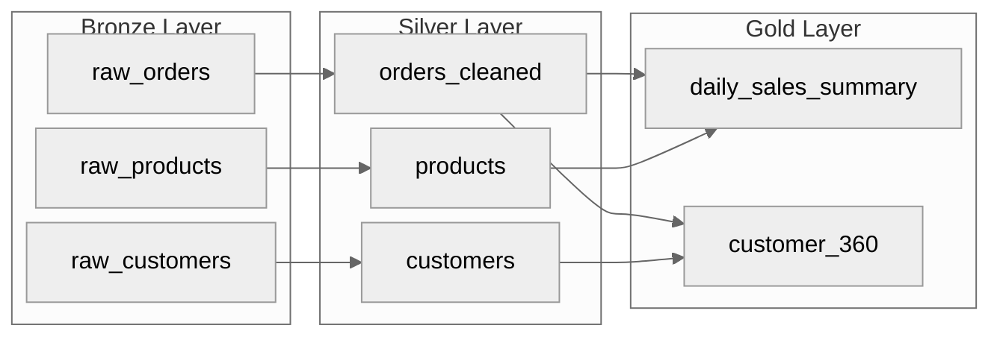
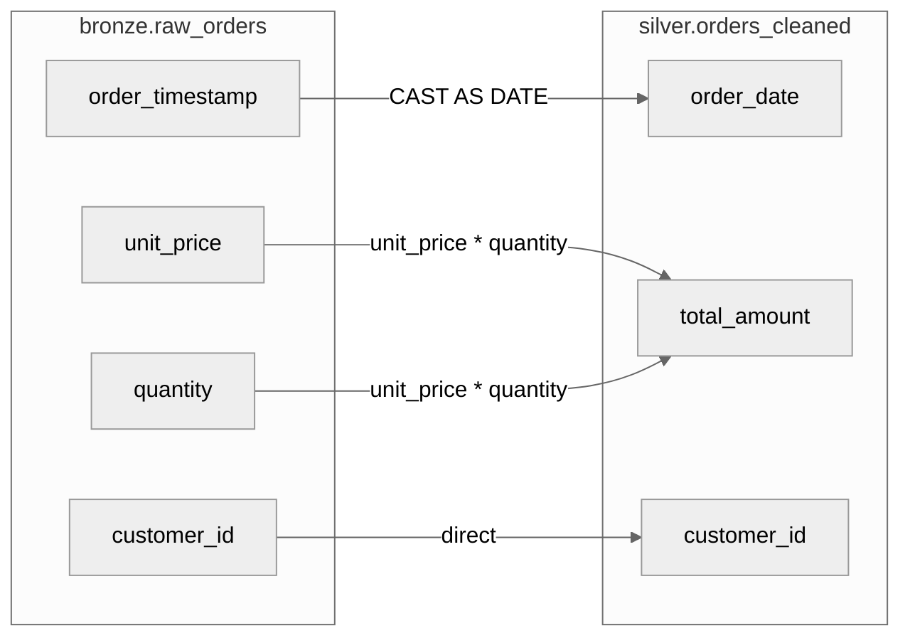

# データリネージ・メタデータ管理

データの出自と変換の流れを追跡し、影響分析とガバナンスを実現するためのルール。リネージの記録方法からメタデータカタログの設計まで網羅する。

---

## 1. リネージの3レベル

| レベル | 粒度 | 把握できること | コスト |
|--------|------|---------------|--------|
| テーブルレベル | テーブル間の依存関係 | どのテーブルがどのテーブルから派生したか | 低い |
| カラムレベル | カラム間のマッピング | 特定カラムがどのソースカラムから来たか | 中程度 |
| 値レベル | 個々のレコードの変換履歴 | 特定の値がどのように計算されたか | 高い |

### 1.1 テーブルレベルリネージ

```python
from dataclasses import dataclass, field

@dataclass(frozen=True)
class TableLineage:
    table_name: str
    source_tables: list[str]
    transformation: str
    pipeline_name: str
    schedule: str

# リネージの定義例
lineage_registry = [
    TableLineage(
        table_name="silver.orders_cleaned",
        source_tables=["bronze.raw_orders"],
        transformation="型変換, NULL除去, 重複排除",
        pipeline_name="pipeline_orders_bronze_to_silver",
        schedule="daily 06:00"
    ),
    TableLineage(
        table_name="gold.daily_sales_summary",
        source_tables=["silver.orders_cleaned", "silver.products", "silver.customers"],
        transformation="JOIN + 日次集計",
        pipeline_name="pipeline_daily_sales",
        schedule="daily 07:00"
    ),
]
```

### 1.2 カラムレベルリネージ

```python
@dataclass(frozen=True)
class ColumnLineage:
    target_table: str
    target_column: str
    source_table: str
    source_column: str
    transformation: str  # "direct", "derived", "aggregated", "constant"
    expression: str | None = None

# カラムリネージの定義例
column_lineage = [
    ColumnLineage(
        target_table="gold.daily_sales_summary",
        target_column="total_revenue",
        source_table="silver.orders_cleaned",
        source_column="order_amount",
        transformation="aggregated",
        expression="SUM(order_amount)"
    ),
    ColumnLineage(
        target_table="silver.orders_cleaned",
        target_column="order_date",
        source_table="bronze.raw_orders",
        source_column="order_timestamp",
        transformation="derived",
        expression="CAST(order_timestamp AS DATE)"
    ),
    ColumnLineage(
        target_table="silver.orders_cleaned",
        target_column="customer_name",
        source_table="bronze.raw_orders",
        source_column="customer_name",
        transformation="direct",
        expression=None
    ),
]
```

### 1.3 値レベルリネージ

個々のレコードがどのソースレコードから派生したかを追跡する。監査要件が厳しい場合に使用。

```python
from pyspark.sql.functions import col, lit, sha2, concat_ws, array

def add_value_lineage(df, source_name: str, key_columns: list[str]):
    """レコードにリネージ情報を付与"""
    return df.withColumn(
        "_lineage_source", lit(source_name)
    ).withColumn(
        "_lineage_source_key",
        sha2(concat_ws("||", *[col(c).cast("string") for c in key_columns]), 256)
    ).withColumn(
        "_lineage_timestamp", current_timestamp()
    )

# 使用例: 変換パイプラインでリネージを伝播
raw_df = add_value_lineage(
    spark.read.table("bronze.raw_orders"),
    source_name="bronze.raw_orders",
    key_columns=["order_id"]
)
```

---

## 2. リネージ記録の方法

### 手動 vs 自動

| 方式 | メリット | デメリット | 適用場面 |
|------|---------|----------|---------|
| 手動（YAML/JSON 定義） | 正確、意図が明確 | 更新漏れのリスク | 小規模〜中規模 |
| 自動（SQL パース） | 常に最新、漏れなし | パース精度の限界 | 大規模 |
| ハイブリッド | 自動を基本に手動で補完 | 運用コストが中程度 | 推奨 |

### 手動リネージ定義（YAML）

```yaml
# lineage/orders_pipeline.yaml
pipeline:
  name: orders_bronze_to_gold
  owner: data-engineering-team
  schedule: "0 6 * * *"

lineage:
  - target: silver.orders_cleaned
    sources:
      - bronze.raw_orders
    transformation: |
      - NULL除去 (order_id, customer_id)
      - 型変換 (order_timestamp → DATE)
      - 重複排除 (order_id 基準)
    columns:
      - target: order_id
        source: bronze.raw_orders.order_id
        type: direct
      - target: order_date
        source: bronze.raw_orders.order_timestamp
        type: derived
        expression: "CAST(order_timestamp AS DATE)"
      - target: total_amount
        source: bronze.raw_orders.unit_price, bronze.raw_orders.quantity
        type: derived
        expression: "unit_price * quantity"

  - target: gold.daily_sales_summary
    sources:
      - silver.orders_cleaned
      - silver.products
      - silver.customers
    transformation: |
      - orders JOIN products ON product_id
      - orders JOIN customers ON customer_id
      - GROUP BY order_date で日次集計
```

### 自動リネージ収集（SQL パース）

```python
import sqlglot
from sqlglot import exp

def extract_table_lineage_from_sql(sql: str) -> dict:
    """SQL 文からテーブルレベルのリネージを抽出"""
    parsed = sqlglot.parse_one(sql)

    # ソーステーブルの抽出
    source_tables = set()
    for table in parsed.find_all(exp.Table):
        source_tables.add(f"{table.db}.{table.name}" if table.db else table.name)

    # ターゲットテーブルの抽出（INSERT INTO / CREATE TABLE AS SELECT）
    target_table = None
    if isinstance(parsed, exp.Insert):
        target = parsed.find(exp.Table)
        if target:
            target_table = f"{target.db}.{target.name}" if target.db else target.name
            source_tables.discard(target_table)

    return {
        "target": target_table,
        "sources": list(source_tables)
    }

# 使用例
sql = """
INSERT INTO gold.daily_sales_summary
SELECT
    o.order_date,
    p.category,
    SUM(o.amount) AS total_amount
FROM silver.orders_cleaned o
JOIN silver.products p ON o.product_id = p.product_id
GROUP BY o.order_date, p.category
"""

lineage = extract_table_lineage_from_sql(sql)
# {'target': 'gold.daily_sales_summary', 'sources': ['silver.orders_cleaned', 'silver.products']}
```

---

## 3. Impact Analysis（変更影響分析）

あるテーブルやカラムを変更した際に、影響を受ける下流を特定する。

```python
from collections import defaultdict

class LineageGraph:
    """リネージの有向グラフ"""

    def __init__(self):
        self._downstream: dict[str, set[str]] = defaultdict(set)
        self._upstream: dict[str, set[str]] = defaultdict(set)

    def add_edge(self, source: str, target: str):
        self._downstream[source].add(target)
        self._upstream[target].add(source)

    def get_downstream_impact(self, table: str) -> list[str]:
        """指定テーブルの変更が影響する下流テーブルを全て取得（再帰的）"""
        visited = set()
        queue = [table]

        while queue:
            current = queue.pop(0)
            if current in visited:
                continue
            visited.add(current)
            for downstream in self._downstream.get(current, []):
                queue.append(downstream)

        visited.discard(table)  # 自分自身は除外
        return sorted(visited)

    def get_upstream_sources(self, table: str) -> list[str]:
        """指定テーブルの上流ソースを全て取得（再帰的）"""
        visited = set()
        queue = [table]

        while queue:
            current = queue.pop(0)
            if current in visited:
                continue
            visited.add(current)
            for upstream in self._upstream.get(current, []):
                queue.append(upstream)

        visited.discard(table)
        return sorted(visited)

# 使用例
graph = LineageGraph()
graph.add_edge("bronze.raw_orders", "silver.orders_cleaned")
graph.add_edge("bronze.raw_products", "silver.products")
graph.add_edge("silver.orders_cleaned", "gold.daily_sales")
graph.add_edge("silver.products", "gold.daily_sales")
graph.add_edge("gold.daily_sales", "gold.monthly_report")

# bronze.raw_orders を変更した場合の影響範囲
impact = graph.get_downstream_impact("bronze.raw_orders")
# ['gold.daily_sales', 'gold.monthly_report', 'silver.orders_cleaned']

# gold.monthly_report の上流ソース
sources = graph.get_upstream_sources("gold.monthly_report")
# ['bronze.raw_orders', 'bronze.raw_products', 'gold.daily_sales', 'silver.orders_cleaned', 'silver.products']
```

---

## 4. メタデータカタログの必須項目

### テーブルメタデータ

| 項目 | 説明 | 例 |
|------|------|-----|
| テーブル名 | 完全修飾名 | `silver.orders_cleaned` |
| 説明 | テーブルの目的 | クレンジング済み注文データ |
| オーナー | 管理チーム/担当者 | data-engineering-team |
| レイヤー | Medallion レイヤー | Silver |
| 更新頻度 | データ更新のスケジュール | 日次 06:00 JST |
| データ鮮度 SLA | 期待される最新データの遅延 | T+1 日 |
| 保持期間 | データの保持ポリシー | 3年間 |
| 行数（概算） | 最新のレコード数 | 約500万件 |
| サイズ（概算） | ストレージ使用量 | 約2GB |
| パーティション | パーティションキー | `process_date` |
| 品質スコア | 直近の品質スコア | 97.5 (Grade A) |

### カラムメタデータ

| 項目 | 説明 | 例 |
|------|------|-----|
| カラム名 | 物理名 | `customer_id` |
| 論理名 | ビジネス名 | 顧客ID |
| データ型 | Spark / SQL 型 | STRING |
| NULL 許可 | NULL を許可するか | NO |
| PII 分類 | 個人情報の分類 | Non-PII |
| 説明 | カラムの意味 | 顧客を一意に識別するID |
| 値の例 | サンプル値 | `CUST-001`, `CUST-002` |
| リネージ | ソースカラム | `bronze.raw_orders.customer_id` |

```python
# メタデータをテーブルコメントとして記録（Delta Lake）
spark.sql("""
    ALTER TABLE silver.orders_cleaned
    SET TBLPROPERTIES (
        'description' = 'クレンジング済み注文データ',
        'owner' = 'data-engineering-team',
        'layer' = 'silver',
        'update_frequency' = 'daily',
        'sla' = 'T+1',
        'retention' = '3 years',
        'pii_columns' = 'customer_name,email',
        'quality_score' = '97.5'
    )
""")

# カラムコメント
spark.sql("""
    ALTER TABLE silver.orders_cleaned
    ALTER COLUMN customer_id COMMENT '顧客を一意に識別するID（Non-PII）'
""")
spark.sql("""
    ALTER TABLE silver.orders_cleaned
    ALTER COLUMN order_date COMMENT '注文日（bronze.raw_orders.order_timestamp から DATE に変換）'
""")
```

---

## 5. Unity Catalog / Purview でのリネージ管理

### Databricks Unity Catalog

```sql
-- Unity Catalog でのテーブルリネージは自動的に収集される
-- Spark SQL / DataFrame API の実行から自動的にリネージが記録される

-- テーブルにタグを付与
ALTER TABLE catalog.schema.orders SET TAGS ('pii' = 'true', 'layer' = 'silver');

-- カラムにタグを付与
ALTER TABLE catalog.schema.orders ALTER COLUMN email SET TAGS ('pii_type' = 'email');
```

### Microsoft Purview

```python
# Purview REST API でリネージを登録
import requests

def register_lineage_in_purview(
    purview_account: str,
    source_entity: str,
    target_entity: str,
    process_name: str,
    token: str
):
    """Purview にリネージ情報を登録"""
    url = f"https://{purview_account}.purview.azure.com/catalog/api/atlas/v2/entity"

    lineage_entity = {
        "entity": {
            "typeName": "Process",
            "attributes": {
                "qualifiedName": process_name,
                "name": process_name
            },
            "relationshipAttributes": {
                "inputs": [{"typeName": "DataSet", "uniqueAttributes": {"qualifiedName": source_entity}}],
                "outputs": [{"typeName": "DataSet", "uniqueAttributes": {"qualifiedName": target_entity}}]
            }
        }
    }

    response = requests.post(
        url,
        json=lineage_entity,
        headers={"Authorization": f"Bearer {token}", "Content-Type": "application/json"},
        timeout=30
    )
    response.raise_for_status()
    return response.json()
```

---

## 6. Mermaid 図でのリネージ可視化

### テーブルレベルリネージ図



### カラムレベルリネージ図



---

## チェックリスト

### リネージ設計時
- [ ] テーブルレベルのリネージを全パイプラインで定義したか
- [ ] 重要なテーブルにはカラムレベルのリネージも定義したか
- [ ] リネージの記録方法（手動/自動/ハイブリッド）を決定したか
- [ ] 影響分析（Impact Analysis）の手順を確立したか

### メタデータ管理
- [ ] 全テーブルにメタデータ（説明, オーナー, 更新頻度）を設定したか
- [ ] PII カラムを特定し、タグ付けしたか
- [ ] カラムコメントを付与したか
- [ ] メタデータの定期更新の仕組みがあるか

### リネージ可視化
- [ ] テーブルレベルのリネージ図を作成したか
- [ ] 重要な変換にはカラムレベルの図も作成したか
- [ ] リネージ図がドキュメントに組み込まれているか
- [ ] スキーマ変更時にリネージ図を更新する運用があるか
