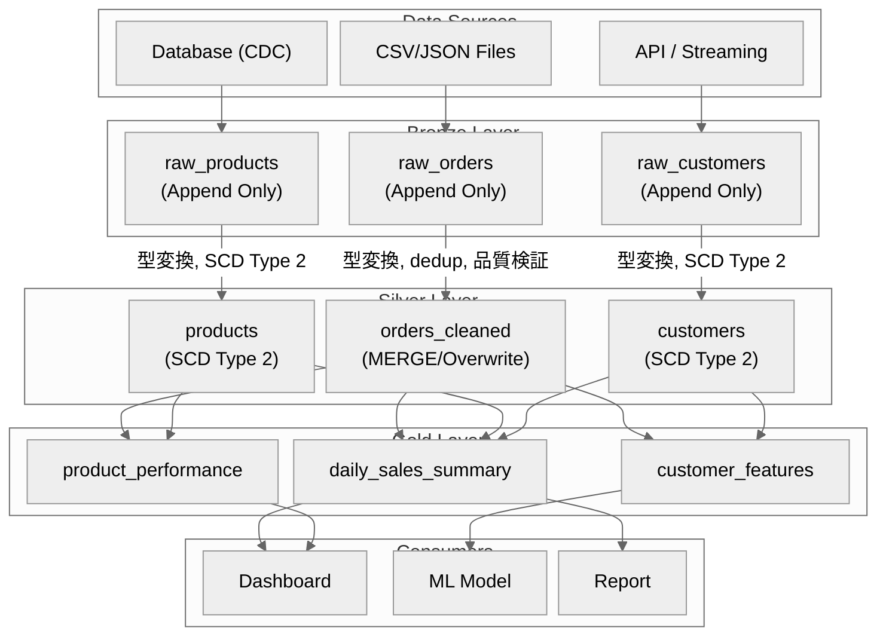

# Medallion アーキテクチャ（Bronze/Silver/Gold）

Lakehouse における3層データアーキテクチャのルール。各レイヤーの責務、品質基準、命名規約、テスト戦略を定義する。

---

## 1. 各レイヤーの責務と品質基準

| 観点 | Bronze | Silver | Gold |
|------|--------|--------|------|
| 目的 | 生データの忠実な保存 | クレンジング・標準化 | ビジネス価値の提供 |
| データ品質 | そのまま（品質チェック前） | 検証済み・クレンジング済み | 集計・加工済み |
| スキーマ | Schema on Read | Schema on Write（緩やか） | Schema on Write（厳密） |
| 更新方式 | Append Only | MERGE / UPSERT / SCD | MERGE / 全量再構築 |
| 保持期間 | 長期（3〜7年） | 中期（1〜3年） | 短〜中期（利用頻度に応じる） |
| アクセス権 | データエンジニアのみ | データエンジニア + アナリスト | 全ユーザー |
| 冪等性 | パーティション上書き | MERGE パターン | 全量再計算 or MERGE |
| データ形式 | ソース形式を維持 | Delta Lake / Iceberg | Delta Lake / Iceberg |

---

## 2. Bronze Layer（生データ取り込み）

### 責務

- ソースデータをそのまま取り込む（変換しない）
- メタデータ（取り込み日時、ソース名、バッチID）を付与する
- Append Only でデータを追記する

### 実装パターン

```python
from pyspark.sql import SparkSession
from pyspark.sql.functions import col, lit, current_timestamp, input_file_name

def ingest_to_bronze(
    spark: SparkSession,
    source_path: str,
    target_table: str,
    source_name: str,
    batch_id: str,
    file_format: str = "csv"
):
    """Bronze レイヤーへの生データ取り込み"""
    # ソースデータの読み取り（スキーマ推論）
    raw_df = (
        spark.read
        .format(file_format)
        .option("header", "true")
        .option("inferSchema", "true")
        .load(source_path)
    )

    # メタデータカラムの付与
    bronze_df = (
        raw_df
        .withColumn("_ingestion_timestamp", current_timestamp())
        .withColumn("_source_name", lit(source_name))
        .withColumn("_batch_id", lit(batch_id))
        .withColumn("_source_file", input_file_name())
    )

    # Append で書き込み
    bronze_df.write \
        .format("delta") \
        .mode("append") \
        .partitionBy("_batch_id") \
        .saveAsTable(target_table)

    record_count = bronze_df.count()
    return {
        "table": target_table,
        "record_count": record_count,
        "batch_id": batch_id
    }
```

### Bronze のルール

```
1. 変換しない: ソースの値をそのまま保存する
2. 削除しない: データは Append Only で追記する
3. メタデータを付与する: _ingestion_timestamp, _source_name, _batch_id
4. スキーマは緩やかに: mergeSchema=true で新カラムを自動追加
```

---

## 3. Silver Layer（クレンジング・標準化）

### 責務

- 型変換（文字列 → 日付、数値等）
- NULL / 欠損値の処理
- 重複排除
- 標準化（命名統一、コード変換）
- SCD の適用（ディメンションテーブル）
- データ品質検証

### 実装パターン

```python
from pyspark.sql import SparkSession, DataFrame
from pyspark.sql.functions import col, trim, upper, to_date, when, row_number
from pyspark.sql.window import Window

def transform_to_silver(
    spark: SparkSession,
    bronze_table: str,
    silver_table: str,
    process_date: str
):
    """Bronze → Silver の変換処理"""
    # Bronze からの読み取り
    raw_df = (
        spark.read.table(bronze_table)
        .filter(col("_batch_id") == process_date)
    )

    # Step 1: 型変換
    typed_df = (
        raw_df
        .withColumn("order_date", to_date(col("order_date_str"), "yyyy-MM-dd"))
        .withColumn("quantity", col("quantity").cast("integer"))
        .withColumn("unit_price", col("unit_price").cast("decimal(10,2)"))
    )

    # Step 2: NULL 処理
    cleaned_df = typed_df.filter(
        col("order_id").isNotNull() &
        col("customer_id").isNotNull()
    )

    # Step 3: 重複排除（最新レコードを残す）
    window = Window.partitionBy("order_id").orderBy(col("_ingestion_timestamp").desc())
    deduped_df = (
        cleaned_df
        .withColumn("_row_num", row_number().over(window))
        .filter(col("_row_num") == 1)
        .drop("_row_num")
    )

    # Step 4: 標準化
    standardized_df = (
        deduped_df
        .withColumn("customer_name", trim(col("customer_name")))
        .withColumn("status", upper(trim(col("status"))))
        .withColumn("total_amount", col("unit_price") * col("quantity"))
    )

    # Step 5: 品質検証
    quality_result = validate_quality(standardized_df)
    if quality_result["score"] < 0.80:
        raise DataQualityError(
            f"Quality score {quality_result['score']} below threshold 0.80"
        )

    # Step 6: Silver テーブルへの書き込み（冪等）
    standardized_df.write \
        .format("delta") \
        .mode("overwrite") \
        .option("replaceWhere", f"process_date = '{process_date}'") \
        .saveAsTable(silver_table)

    return quality_result
```

### Silver のルール

```
1. 型を正しく変換する: 文字列→適切な型
2. 重複を排除する: 主キーベースでの dedup
3. NULL を明示的に処理する: 削除 or デフォルト値 or エラーテーブルへ分離
4. 命名を統一する: snake_case, ビジネス用語を使用
5. 品質スコアが閾値未満なら処理を停止する
```

---

## 4. Gold Layer（集計・ビジネスロジック）

### 責務

- ビジネスKPIの算出
- ディメンショナルモデリング（Star Schema / Snowflake Schema）
- ダッシュボード用の事前集計
- ML Feature Store 用の特徴量テーブル

### 実装パターン

```python
def build_gold_daily_sales(
    spark: SparkSession,
    process_date: str
):
    """Gold: 日次売上サマリーの構築"""
    daily_sales = spark.sql(f"""
        SELECT
            o.order_date,
            p.category AS product_category,
            c.region AS customer_region,
            COUNT(DISTINCT o.order_id) AS order_count,
            COUNT(DISTINCT o.customer_id) AS unique_customers,
            SUM(o.total_amount) AS total_revenue,
            AVG(o.total_amount) AS avg_order_value,
            SUM(o.quantity) AS total_units_sold
        FROM silver.orders o
        JOIN silver.products p ON o.product_id = p.product_id
        JOIN silver.customers c ON o.customer_id = c.customer_id
        WHERE o.process_date = '{process_date}'
        GROUP BY o.order_date, p.category, c.region
    """)

    daily_sales.write \
        .format("delta") \
        .mode("overwrite") \
        .option("replaceWhere", f"order_date = '{process_date}'") \
        .saveAsTable("gold.daily_sales_summary")
```

### ML Feature Store パターン

```python
def build_customer_features(spark: SparkSession):
    """Gold: 顧客特徴量テーブルの構築"""
    features = spark.sql("""
        SELECT
            c.customer_id,
            -- 基本属性
            c.region,
            c.customer_segment,
            -- 購買行動特徴量
            COUNT(o.order_id) AS total_orders,
            SUM(o.total_amount) AS lifetime_value,
            AVG(o.total_amount) AS avg_order_value,
            DATEDIFF(current_date(), MAX(o.order_date)) AS days_since_last_order,
            DATEDIFF(current_date(), MIN(o.order_date)) AS customer_age_days,
            COUNT(DISTINCT p.category) AS distinct_categories,
            -- 計算特徴量
            CASE
                WHEN DATEDIFF(current_date(), MAX(o.order_date)) <= 30 THEN 'ACTIVE'
                WHEN DATEDIFF(current_date(), MAX(o.order_date)) <= 90 THEN 'AT_RISK'
                ELSE 'CHURNED'
            END AS activity_status
        FROM silver.customers c
        LEFT JOIN silver.orders o ON c.customer_id = o.customer_id
        LEFT JOIN silver.products p ON o.product_id = p.product_id
        GROUP BY c.customer_id, c.region, c.customer_segment
    """)

    features.write \
        .format("delta") \
        .mode("overwrite") \
        .saveAsTable("gold.customer_features")
```

---

## 5. レイヤー間のデータフロー



---

## 6. 命名規約

### テーブル名

| レイヤー | パターン | 例 |
|---------|---------|-----|
| Bronze | `bronze.raw_{source}_{entity}` | `bronze.raw_erp_orders` |
| Silver | `silver.{entity}` | `silver.orders`, `silver.customers` |
| Gold | `gold.{domain}_{purpose}` | `gold.sales_daily_summary` |
| メタ | `meta.{purpose}` | `meta.pipeline_execution_log` |
| ステージング | `staging.{source}_{entity}` | `staging.erp_orders` |

### カラム名

| ルール | 例 |
|--------|-----|
| snake_case を使用 | `customer_name`, `order_date` |
| ビジネス用語を使用（技術用語を避ける） | `order_date`（not `col1`） |
| 単位をサフィックスに含める | `amount_jpy`, `weight_kg`, `duration_seconds` |
| ブール型は `is_` / `has_` プレフィックス | `is_active`, `has_discount` |
| 日時型は `_at` / `_date` サフィックス | `created_at`, `order_date` |
| ID は `_id` サフィックス | `customer_id`, `product_id` |
| メタカラムは `_` プレフィックス | `_ingestion_timestamp`, `_batch_id` |

### 予約されたメタカラム

| カラム名 | レイヤー | 用途 |
|---------|---------|------|
| `_ingestion_timestamp` | Bronze | 取り込み日時 |
| `_source_name` | Bronze | データソース名 |
| `_batch_id` | Bronze | バッチ識別子 |
| `_source_file` | Bronze | ソースファイルパス |
| `process_date` | Silver/Gold | 処理対象日 |
| `is_current` | Silver (SCD2) | 現在有効なレコードか |
| `effective_start_date` | Silver (SCD2) | 有効開始日時 |
| `effective_end_date` | Silver (SCD2) | 有効終了日時 |
| `created_at` | Silver/Gold | レコード作成日時 |
| `updated_at` | Silver/Gold | レコード更新日時 |

---

## 7. 各レイヤーのテスト戦略

| テスト種別 | Bronze | Silver | Gold |
|-----------|--------|--------|------|
| スキーマテスト | カラム存在確認 | 型の正確性, NOT NULL | 集計カラムの存在 |
| データ品質 | レコード件数チェック | 6次元品質検証 | KPI の妥当性 |
| 冪等性テスト | 2回実行で件数同一 | 2回 MERGE で結果同一 | 2回実行で結果同一 |
| リネージテスト | ソース→Bronze の件数一致 | Bronze→Silver の追跡 | Silver→Gold の整合性 |
| パフォーマンステスト | 取り込み速度 | 変換の所要時間 | クエリレイテンシ |

```python
# Bronze テスト: 件数の一致
def test_bronze_record_count(spark, source_path, bronze_table, batch_id):
    source_count = spark.read.csv(source_path, header=True).count()
    bronze_count = (
        spark.read.table(bronze_table)
        .filter(col("_batch_id") == batch_id)
        .count()
    )
    assert source_count == bronze_count, (
        f"Record count mismatch: source={source_count}, bronze={bronze_count}"
    )

# Silver テスト: 品質スコア
def test_silver_quality(spark, silver_table, process_date):
    df = spark.read.table(silver_table).filter(col("process_date") == process_date)
    null_rate = df.filter(col("order_id").isNull()).count() / df.count()
    assert null_rate == 0, f"order_id has {null_rate*100}% NULLs"

# Gold テスト: 集計の整合性
def test_gold_aggregation(spark, process_date):
    silver_total = spark.sql(f"""
        SELECT SUM(total_amount) FROM silver.orders
        WHERE process_date = '{process_date}'
    """).collect()[0][0]

    gold_total = spark.sql(f"""
        SELECT SUM(total_revenue) FROM gold.daily_sales_summary
        WHERE order_date = '{process_date}'
    """).collect()[0][0]

    assert abs(silver_total - gold_total) < 0.01, (
        f"Aggregation mismatch: silver={silver_total}, gold={gold_total}"
    )
```

---

## チェックリスト

### アーキテクチャ設計時
- [ ] Bronze/Silver/Gold の各レイヤーの責務を明確に定義したか
- [ ] 各レイヤーの品質基準（品質スコアの閾値）を定義したか
- [ ] レイヤー間のデータフロー図を作成したか
- [ ] 命名規約（テーブル名, カラム名, メタカラム）を定義したか

### パイプライン実装時
- [ ] Bronze: メタデータカラムを付与しているか
- [ ] Bronze: Append Only で書き込んでいるか
- [ ] Silver: 型変換, NULL 処理, 重複排除を実施しているか
- [ ] Silver: 品質検証を変換パイプラインに組み込んでいるか
- [ ] Gold: ビジネスKPIの計算ロジックが正しいか
- [ ] 各レイヤーの冪等性を確保しているか

### テスト実施時
- [ ] レイヤー間の件数整合性をテストしているか
- [ ] 品質スコアの閾値テストがあるか
- [ ] 冪等性テスト（2回実行で同一結果）を実施しているか
- [ ] Gold レイヤーの集計ロジックを Silver のデータで検算しているか
